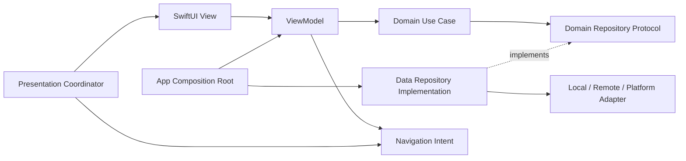
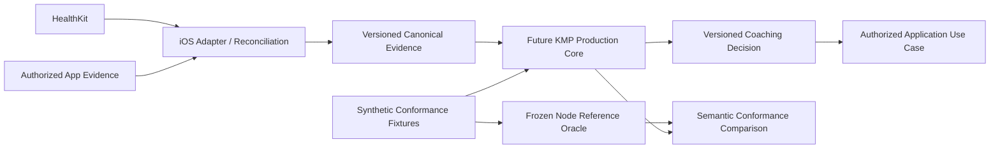

# ADR 0001 — Feature boundaries and separation of coaching runtimes

Status: accepted as **future implementation guidance within this foundation's scope**; not product implementation or R7-A approval. Date: 2026-10-30. Owner: Engineering; security constraints reviewed by Security; sporting semantics remain with existing domain authorities.

## Context and decision

V1 is iOS/iPhone; Apple Health inbound is required, direct manufacturers/watch delivery are POST_V1, and HealthKit write-back remains an open product/technical decision. The [current Canon filter](../../../canon/CANONICAL_INDEX.md) defines these constraints. Experience architecture is not fixed here. The existing `CoachingCore/` is a Node Reference Oracle frozen at `7d2da3603e224124696a2290766ec448080f3264`, not a production deployment target.

Use pragmatic Clean Architecture + MVVM-C and feature organization. Establish logical boundaries first; extract build modules when dependency enforcement, independent ownership/build time or demonstrated reuse warrants it. Do not create three empty packages per screen or a protocol for every type. Select deployment vendors, persistence engines, minimum OS, Kotlin export tooling and backend framework in future authorized work based on actual constraints.

## iOS target

```text
App/                         composition root, lifecycle, AppCoordinator
Features/<Capability>/
  Presentation/              SwiftUI views, @MainActor ViewModels, feature Coordinator
  Domain/                    models, business actions/use cases, repository ports
  Data/                      DTO mapping, repository implementations, local/remote sources
Platform/                    HealthKit, StoreKit, notification, Keychain, analytics adapters
Shared/                      only proven cross-feature primitives; no miscellaneous services bag
CoachingProductionCore/      future KMP facade; canonical evidence in, decisions out
```

Folders are conceptual examples, not approved screens/features. The first app PR chooses names/packages from the then-current product structure.



Arrows represent compile-time dependencies, except the labeled implementation relation. Calls reach Data through injected Domain ports. Presentation imports Domain; Data imports Domain; Domain imports neither. Only the composition root imports concrete implementations to wire them. Domain has no SwiftUI, URLSession, SwiftData/CoreData, HealthKit, StoreKit, Firebase/vendor SDKs or KMP platform handles. Foundation value types may be used deliberately without smuggling platform I/O into Domain. DTOs, database records and SDK objects stop at adapters; domain types preserve units, timestamps, provenance and missingness.

Views render state and emit actions. ViewModels own presentation state, call use cases and expose navigation intents; they do not perform HTTP, billing verification, persistence or coaching policy. Coordinators own routes, deep-link validation, child lifetimes and navigation; they do not become business engines or global state stores. A use case represents a business action/transaction, not every getter. Repository ports express domain needs rather than CRUD for every table. Data maps remote/local failures to stable domain errors and defines cache freshness/consistency explicitly.

Inject dependencies through initializers from `App` factories/composition root. Start with manual DI, feature-scoped lifetimes and explicit authenticated-session lifetime; logout cancels tasks and releases session caches. No service locator, globally mutable singleton, runtime DI framework or recursive dependency graph. Share a module only after a second concrete consumer needs the same stable contract; cross-feature orchestration uses a use case/coordinator rather than importing another feature's internals. Add import/dependency checks when real build modules exist.

Platform adapters isolate HealthKit permission/query/anchor behavior, StoreKit transactions, notification scheduling, Keychain and analytics. They translate into narrow ports and canonical values. SDK availability/failure is represented honestly; no empty-health-data => permission-denied inference, invented samples or vendor-specific sporting rules. Android adapters are not part of V1.

## Coaching runtime contract



The Reference Oracle remains the reproducible specification/evidence implementation. Do not ship it inside the app, expose it as a production HTTP service, migrate it incidentally, or treat a port as permission to change policy. The future KMP common domain is deterministic and UI/platform/vendor agnostic: no HealthKit/UIKit/SwiftUI, device APIs, auth tokens, analytics, network, database, billing or UI routing. Adapters own those effects; common code receives validated immutable evidence, explicit clock/time zone and seeded randomness only when required. No ambient current time, locale, unordered-map ordering or hidden persistence dependence.

Before porting, define a versioned serializable contract for evidence/decision schemas, units, stable IDs, provenance, timestamps/time zones, unknown/absent values, ordering, revisions, eligibility/authority and errors. Preserve current semantics rather than inventing new ones here. Evidence validation is not trust: server-authored facts carry server authority; local/imported facts retain their origin/confidence. A decision is a proposal with traceable input/policy versions; separate application use cases own confirmation, persistence and effects. Inspection/calculation never silently mutates historical state.

Future Node↔KMP conformance runs identical synthetic/golden fixtures on the frozen/version-selected Oracle and KMP. Compare semantic outputs, reasons, authority, safety, unknowns and state transitions, not incidental JSON key order. Document numeric precision/rounding and allow tolerance only per field with domain approval; never blanket tolerances for authority or dose. Include malformed/stale/duplicate evidence, replay, cancellation boundaries and regression fixtures. Track input/output schema + policy/engine versions; a mismatch blocks port adoption until explained and independently reviewed. No conformance implementation or KMP build starts in this foundation.

## Backend target and authority

Prefer a modular monolith with bounded capabilities and one transactional datastore until measurements justify extraction. HTTP handlers authenticate, validate schema/size and map responses. Application use cases enforce authorization/business actions and transaction boundaries. Domain owns invariants and repository protocols. Infrastructure implements storage, provider clients, queues, identity and audit sinks. Dependency direction is the same as on iOS. No framework types in Domain or database queries from handlers.

```text
Untrusted client -> transport/authentication -> application use case -> Domain ports
                                                                    ^
                                     database/provider adapters -----+
```

The server derives subject/session from a verified identity provider token (signature, issuer, audience, validity and revocation/session policy); it never accepts client `userId`, roles, entitlement flags or claimed purchase success as authority. Each action authorizes object ownership and field-level operations at the use case and query scope; database row policies are defense in depth. Store entitlements come from server verification and reconciled signed provider events, including refunds/revocations and event freshness. Client display/cache and offline access rules require a separate bounded contract.

At every public boundary: allowlisted schema, bounds, units, server-owned fields, parameterized queries and safe error categories. Use principal + operation + idempotency key + request digest for mutations that may retry. Atomically persist key/result with the transaction; same key/different payload is a conflict; define TTL and replay window in the endpoint contract. Retry only transient failures with bounded exponential backoff/jitter; do not retry non-idempotent work blindly. Rate/size/concurrency limits apply per identity/IP/operation, with tighter budgets for auth, export, deletion and expensive coaching operations. Values require workload evidence, not guesses.

Persistence needs versioned reviewed migrations, tested on a representative synthetic snapshot. Use expand/migrate/contract for incompatible changes; separate app rollback from irreversible data migration. DB credentials are least privilege and environment scoped; administrative/migration credentials never reach apps. Choose indices from query plans, bounded pagination and measured cardinality; prohibit unbounded fan-out/N+1 queries. Background jobs have bounded retries, deduplication, cancellation and dead-letter/failed-job inspection. Add an outbox only if transaction + asynchronous publication actually requires it.

Before live data: define encrypted backups, isolated restore rehearsal, deletion tombstone replay after restore, RPO/RTO, retention, operational owner and evidence. Audit security-relevant changes with minimal metadata and restricted access. [Security](../SECURITY.md) owns trust controls, logs and response; [Privacy](../PRIVACY.md) owns lifecycle decisions. This ADR selects no provider and provisions no server.

## Alternatives, consequences and revisit triggers

Rejected for now: layer-only global folders (weak feature ownership); microservices (unsupported operational cost); protocol-everything/DI framework (indirection without need); direct SDK access from ViewModels (coupled, hard-to-test authority); a shared KMP UI/full-stack layer (violates iOS/product and pure-core boundaries). A simple cohesive type is preferable where no boundary exists.

Benefits are replaceable I/O, focused tests and explicit authority. Costs are mapping and some duplicated platform code; avoid abstracting unrelated behaviors just to remove duplication. Revisit module granularity when builds/team ownership suffer, a second platform is authorized, sync/consistency requirements become concrete, or profiling proves a deployable boundary inadequate. Material authority/persistence changes get a successor ADR; implementation details do not.
