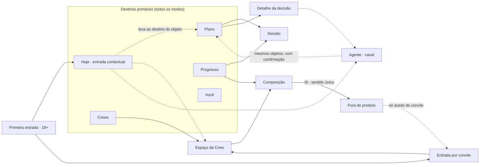

# Vilumo Fit — Product Architecture

| Campo | Valor |
|---|---|
| Revisão | **PA-0.1** · 2026-10-11 |
| Linhagem | Primeira revisão. Phase 4 CP-B, sobre a CP-A (PTM, PDM e PDR 0.5), com a decisão do Founder sobre experiência híbrida (2026-10-11) e as re-revisões UX-J3, PCG-J3 e SEC-J3 de 2026-10-11 |
| Natureza | Artefato de trabalho: arquitetura de produto e Shareable Object Model (C026) do escopo de design desta missão. Não canônico. Não fixa estilo visual, telas, componentes, componente de navegação, quantidade de telas, rótulos finais nem tecnologia |
| Autoridade | **VILUMO-PTC-2.2.0** (`canon/VILUMO_FIT_PRODUCT_THESIS_CONTRACT.md`), SHA-256 `5c780fdc336166066edbc9ed62dfa0e947efdb5177898faf6c934346f6e35601`. Decisão do Founder de 2026-10-11, experiência híbrida (`audits/founder-decisions/2026-10-11_hybrid-experience-founder-decision.md`, SHA-256 `1db720f2a77593a8771b0473ddb9379bcbe392bbcd4dea7bfd0040edff08ef27`), vigente pelo §2 do Canon e em formalização pelo PCG como PTC-2.3.0. O rascunho, em revisão e não canônico, traz C028–C037, H008 e O015; os IDs serão sincronizados depois da publicação. Conflito entre as duas fontes vai ao PCG |
| Base | PDM-0.6 `af3692601d6ee3f549a299d3bb3e8693ce68c665cad0a1a83d8ad617348d416c` (PDM-0.5 com o agente e UX-J3-01/05). PDR-0.5 `dec6fab36d458abddddcac9ec5fea63163c6b436a3ec77c8d2f75f9d95c25498`, com os registros desta revisão em PDR-0.6. PTM-0.5.1 `5048e0a08bb6ad836d8f5ce6ecea3353601f1da4d131a42927aed93945100b7b`. O PDM prevalece sobre esta arquitetura; os refinamentos que ela propõe ao PDM estão em PA §17 |
| Autor (worker) | Product/UX Architect |
| Gate | `PRODUCT_ARCHITECTURE_APPROVED`: pendente de revisão independente (UX-J, PCG-J, SEC-J; AI Systems para o agente). SEC-J-03, SEC-J3-01, SEC-J-10, SEC-J2-03 e SEC-J3-08 fecham com a revisão Security desta revisão. A autoavaliação (PA §18) é do worker. Este documento não se autoaprova |

## 0. Como ler

- **Rótulos:** **[C]** só texto que o Canon afirma; **[F]** texto ou princípio da decisão do Founder de 2026-10-11; **LD** leitura derivada; **[P]** proposta de arquitetura dentro do design space (D009); **[A]** aberto (DR, CPB ou O no PDR).
- **IDs desta arquitetura:** **AR-nn** regra de arquitetura, [P] salvo rótulo próprio · **E1–E7** entradas · **EXP-0 a EXP-3** níveis de exposição · **ALT-n** alternativas · **J1–J11** jornadas de prova · **NC-nn** casos negativos de Security. Entidades, estados e contratos (I1–I10, M1–M3, S, X, A) são os do PDM e não são redefinidos aqui.
- **Referências:** "§n" sem prefixo é seção do Canon; "PA §n", "PDM §n" e "PDR §n" são seções deste documento, do PDM-0.6 e do PDR-0.6.
- **Destino primário** é um lugar estável que a navegação mantém sempre alcançável; **superfície** é um lugar de interação aberto a partir de destinos ou objetos. Os nomes são funcionais. Rótulos nos dois idiomas, componente de navegação e quantidade de telas: UI & Experience e fase 18.
- Os exemplos de interação da decisão do Founder (iniciar ou pausar treinos, registrar séries, corrigir cargas, acompanhar intervalos, registrar alimentação) são classes de tarefa, não funcionalidades novas nem obrigações de lançamento [F].

## 1. Outcomes, decisão do Founder e limites

[C §30] Product/UX "deve conseguir representar valor sem Crew, entrada social leve, contribuição assimétrica, cumprimento correto de recuperação, interrupção/retorno e apoio consentido sem fiscalização", e "os conceitos sociais não precisam virar destinos separados". CURRENT_MISSION §4 pede topologia, arquitetura de informação, navegação, hierarquia de objetos, entradas, modos, superfícies, divulgação progressiva, interações entre pilares, estados e o Shareable Object Model.

[F] "o Vilumo Fit deve adotar uma experiência híbrida, com entrada simples e contextual, execução direta e profundidade acessível"; "Quantidade mínima de telas não é uma meta". A decisão não fixa tabbar, quantidade de telas, nomes de destinos nem escopo novo.

| Princípio [F] | Onde esta arquitetura o aplica |
|---|---|
| 1 · Entrada contextual | Hoje (PA §2.1); AR-02, AR-03 |
| 2 · Execução direta | PA §5; AR-12 a AR-15; J10 |
| 3 · Profundidade por modalidade | PA §5; AR-16 a AR-18 |
| 4 · Agente para coordenação e decisões | PA §6; AR-21 a AR-23, AR-27; J11 |
| 5 · Consistência entre agente e telas | AR-05, AR-24 a AR-26 |
| 6 · Detalhes sob demanda | AR-04; PA §4.3 |
| 7 · Navegação previsível | AR-01, AR-05, AR-13 |
| 8 · Social acessível | PA §9; AR-30 |
| 9 · Identidade preservada | Nota de handoff (PA §16) |

**Não adotado:** soluções que dependem de O013 (DR-48) ou de O014 (DR-49); conceitos sociais DA, que ficam como pontos de extensão; food logging completo (D004); um contrato de confirmação, desfazer e autonomia do agente, que é lacuna registrada (DR-51).

## 2. Topologia e navegação

**Modelo [P] (ALT-1):** uma entrada contextual sobre quatro destinos estáveis, com o agente como canal. A decisão do Founder não fixa destinos: estes são escolha de arquitetura (D009), revisável.

### 2.1 Destinos primários

| Destino | Pergunta | Papel | Objetos canônicos (PDM) |
|---|---|---|---|
| **Hoje** | "O que importa agora?" | Entrada contextual: o previsto, a próxima ação, mudanças relevantes e compromissos pertinentes [F 1]. Não reúne todas as capacidades | Nenhum: Hoje seleciona e prioriza objetos que vivem nos outros destinos (AR-03) |
| **Plano** | "O que está previsto para mim e como faço?" | Lugar estável da prática: janela atual e próximos dias; iniciar, registrar e repetir sessões; registrar alimentação relevante e sinais do dia; declarar desfecho, interrupção e retomada | Decisão de Adequação vigente e Plano (Full Member); Intenção declarada (Crew Member); Desfecho da janela; Interrupção e Retorno; registros do dia |
| **Progresso** | "Como venho continuando?" | Histórico e análise, sob demanda [F 6] | Registro de Continuidade e marcos; Trajetória e progresso em Goals; Sessões realizadas (Training Context) |
| **Crews** | "Como fazemos para continuar?" | Caminhos reconhecíveis para participar, reencontrar as próprias Crews, acompanhar compromissos e compartilhar [F 8] | Minhas Crews (até 3), convites recebidos, criação de Crew; cada Crew tem um espaço (PA §9.1) |
| **Você** | "O que o Vilumo sabe de mim e o que eu permito?" | Contexto, privacidade e conta | Meu contexto (práticas, objetivos, agenda e disponibilidade, fontes, contexto estável de recuperação e alimentação); Privacidade (consentimentos, bloqueios, projeções, meus dados); Conta (modo, idioma, encerramento) |

### 2.2 Superfícies que não são destinos

| Superfície | Aberta a partir de | Função | Limite |
|---|---|---|---|
| Primeira entrada | instalação; link de convite; criação de Crew por quem ainda não entrou | verificação de idade (AR-09), escolha do caminho, contexto mínimo (AR-11) | não é ritual fixo de onboarding (§30) |
| Entrada por convite | link nominal; objeto de convite | estado do convite, divulgação de consentimento e aceite (PA §9.4) | nunca inscreve por si (C025) |
| Sessão | Hoje (próxima ação); Plano; Progresso (repetir) | executar e registrar com os controles da modalidade (PA §5) | uma instância por sessão (AR-05) |
| Detalhe da decisão | Hoje; Plano; agente | justificativa, confiança, recuperação e alimentação consideradas, alternativas admissíveis | incerteza nunca escondida (C012) |
| Espaço da Crew | Crews; Hoje (minha parte); aviso | facetas da Crew (PA §9.1) | um por Crew; conceitos sociais são facetas |
| Composição de compartilhamento | ação em objeto elegível | compor e projetar (PA §10) | não é galeria, feed nem destino |
| Agente | entrada consistente nas superfícies de AP; contexto de conflito ou decisão | coordenação (PA §6) | não é destino, entrada nem caminho único |
| Avisos do sistema | sistema operacional | levar ao destino do objeto | pessoais (AR-07); telas do telefone: SEC-J3-05, fase 8 |

### 2.3 Regras de navegação

- **AR-01** [P; F 1, 7] Os cinco destinos existem em todos os modos e têm a mesma estrutura interna para todas as pessoas; nenhum some ou é bloqueado por modo. O conteúdo varia por modo (PA §4.2). A personalização muda só prioridade e conteúdo contextual.
- **AR-02** [P; F 1] Hoje é a entrada e é a única área cuja seleção e ordem de itens mudam com o contexto; nos demais destinos, os dados mudam, mas a estrutura e a ordem ficam estáveis. Mostra o previsto (decisão ou intenção da janela), a próxima ação, mudanças relevantes (replanejamento, queda de confiança, fonte desconectada, falha de sincronização, mudança num compromisso, convite ou confirmação que espera a pessoa) e a própria parte nos compromissos. Não mostra histórico, análises, configurações, catálogos nem atividade de outras pessoas.
- **AR-03** [P] Hoje não é dono de objeto: cada item leva ao objeto no seu destino estável ou o abre na mesma instância. Nenhuma tarefa existe só em Hoje.
- **AR-04** [P; F 6] Histórico, análises avançadas e explicações completas ficam em caminhos descobríveis: Progresso, detalhe da decisão, detalhe da sessão. Ações frequentes, erros relevantes, problemas de sincronização e incertezas que afetam a decisão aparecem no primeiro nível de onde a pessoa está (C012).
- **AR-05** [P; F 5, 7] Cada objeto tem um destino canônico (PA §3). Outras entradas, inclusive o agente, abrem a mesma instância, nunca uma cópia com estado próprio.
- **AR-06** [P; LD de L003 e §30] Nenhuma modalidade e nenhum conceito social tem destino primário. Modalidades aparecem pela Capacidade esportiva (PA §5); conceitos sociais, como facetas do espaço da Crew (PA §9.1).
- **AR-07** [P] Avisos são pessoais: tratam de objetos da própria pessoa, de convites e confirmações pedidos a ela, de re-consentimento e da entrada de alguém numa Crew dela (SEC-J-03). Nunca citam estado, ausência, atraso ou dependência do grupo em outra pessoa (SEC-J-02).
- **AR-08** [C §13] "Listagem ou busca pública de Crews e ingestão da agenda de contatos estão excluídas." [P] Também não há diretório de pessoas nem perfil visível fora das Crews (LD de L012).

### 2.4 Mapa

## 3. Hierarquia de objetos

Objeto canônico → destino canônico. Outras entradas abrem a mesma instância (AR-05); não são destinos concorrentes.

| Objeto (PDM) | Destino canônico | Outras entradas | Quem vê |
|---|---|---|---|
| Decisão de Adequação vigente; Plano | Plano | Hoje; detalhe da decisão; agente; aviso | a pessoa |
| Intenção declarada | Plano | Hoje; agente | a pessoa; nunca cruza (PDM §8.1) |
| Desfecho da janela | Plano | Hoje; Sessão; agente; aviso | a pessoa |
| Interrupção e Retorno | Plano | Hoje; agente | a pessoa |
| Sessão realizada | Progresso | Sessão; Plano (dia) | a pessoa |
| Registro de Continuidade, marcos, Trajetória, progresso em Goals | Progresso | Hoje (marco recente) | a pessoa |
| Goals, Schedule, Práticas de modalidade, fontes, contexto estável de recuperação e alimentação | Você › Meu contexto | Plano (disponibilidade do dia); Hoje (pedido de contexto); agente (preparar) | a pessoa |
| Registros do dia: alimentação relevante, sinais de recuperação autodeclarados | Plano (dia) | Hoje; Sessão; agente | a pessoa |
| Declaração de suporte (catálogo) | Estado de cada prática em Você › Meu contexto (AR-18) | — | a pessoa |
| Crew | Espaço da Crew | Crews; Hoje; aviso | participantes |
| Vínculo próprio | Espaço da Crew › minha participação | Você › Privacidade | a pessoa; participantes veem só "Em pausa" |
| Convite recebido | Crews › convites recebidos | link; aviso | o convidado |
| Convite emitido; confirmação pedida | Espaço da Crew › convites | aviso | quem convidou |
| Compromisso compartilhado | Espaço da Crew | Hoje (minha parte) | participantes |
| Contribuição própria | Espaço da Crew › período | Hoje e Plano, depois do desfecho | participantes, com a audiência de AR-32 |
| Apoio | Espaço da Crew › período | aviso pessoal | quem envia e quem recebe (AR-55) |
| Progresso coletivo | Espaço da Crew | — | participantes |
| Objeto compartilhável | Sem destino: nasce do objeto de origem e é composto na Composição (AR-57) | — | a pessoa, até projetar |
| Projeção externa (registro) | Você › Privacidade › projeções | — | a pessoa |
| Consentimento | Você › Privacidade, registro único | espaço da Crew; Composição; primeiro uso de dado sensível | a pessoa |
| Modo; Acesso a capacidades | Você › Conta | — | a pessoa; nunca outras pessoas (AR-10) |
| Meus dados: acesso, exportação, eliminação | Você › Privacidade | — | a pessoa |
| Conversa com o agente | Não é objeto de domínio (AR-26); registro pessoal acessível em Você › Privacidade | — | a pessoa |

## 4. Entradas, modos e divulgação progressiva

### 4.1 Entradas

| Entrada | Caminho | Portão | Resultado |
|---|---|---|---|
| E1 · instalação sem convite | Primeira entrada | idade | orientação pessoal (Full Member, M1) ou criar uma Crew (Crew Member, M3); nenhuma é pré-requisito da outra (L009, C004) |
| E2 · link de convite nominal, sem conta | Primeira entrada → Entrada por convite | idade; comprovação do canal (AR-41) | Crew Member após aceite e consentimento; sem comprovação, aceite pendente de confirmação |
| E3 · objeto de convite, sem conta | idem | idade; confirmação de quem convidou, sempre | idem |
| E4 · convite com conta | Crews › convites recebidos ou link | comprovação do canal; a idade já foi verificada | novo vínculo, dentro do limite (AR-37) |
| E5 · criação de Crew, sem conta | Primeira entrada | idade | Crew Member, primeiro participante de uma Crew Em formação |
| E6 · criação de Crew, com conta | Crews | — | novo vínculo, dentro do limite |
| E7 · aviso do sistema | destino canônico do objeto | sessão autenticada | — |

- **AR-09** [P; CPB-11; SEC-J3-01, SEC-J3-02] Todo caminho que cria identidade no produto (E1, E2, E3, E5) passa uma vez pela verificação de idade; sem ela concluída não há conta, vínculo, aceite nem Crew criada. Fica guardado só o resultado ("adulto: sim") e um fato mínimo de auditoria; documento, data de nascimento ou biometria, só o que o método escolhido estritamente exigir. Uma falha não deixa perfil guardado, e o contato do convidado é descartado (AR-46). Quem convidou vê só "não aceito/expirado" (AR-44). Um verificador terceiro é nova fronteira de confiança e pede revisão Security quando o método for escolhido (DR-53).
- **AR-10** [P; SEC-J-07, SEC-J2-07; DR-34] O modo nunca é visível a outras pessoas, e nenhuma superfície social varia de forma que o revele. Adotar a experiência pessoal é opção do Crew Member, oferecida só na Primeira entrada e em Você › Conta, nunca como condição ou lembrete recorrente (C004, D008, L009). Deixá-la segue a regra de destino dos dados do PDM §6.1, e o acesso a capacidades continua separado do modo (DR-12).
- **AR-11** [P; DR-32] A Primeira entrada pede só o necessário ao caminho escolhido. Para orientação pessoal, as práticas e a disponibilidade; objetivos e fontes podem vir depois. Para Crew Member, só nome de exibição e o consentimento da Crew, sem dado de treino (C004). Sem dados, a primeira decisão sai com confiança explícita, e o produto pede contexto quando ele mudaria a decisão. Dado sensível só é pedido no primeiro uso, com consentimento explícito (D-CHIEF-03). Nenhum pedido de contexto bloqueia valor (L009, C012).

### 4.2 Modos e destinos

| Destino | M1 · Full Member sem Crew | M2 · Full Member em Crew | M3 · Crew Member | Sem modo vigente |
|---|---|---|---|---|
| Hoje | previsto, próxima ação, mudanças | M1, mais a própria parte nos compromissos | Intenção do período, próxima declaração, própria parte | escolher um caminho, sem pressão |
| Plano | decisão, próximos dias, sessões, alimentação relevante, interrupção | idem | Intenção do período, desfecho declarado, interrupção | caminhos de entrada |
| Progresso | Registro, marcos, Trajetória, Goals, sessões | idem | Registro e marcos declarados | Registro anterior |
| Crews | criar; convites recebidos (estado vazio sem pressão) | minhas Crews | minhas Crews | criar; convites recebidos |
| Você | Meu contexto completo; Privacidade; Conta | idem | Privacidade; Conta (adotar a experiência pessoal) | Privacidade; Conta |

### 4.3 Primeiro nível e detalhes sob demanda [F 6]

| Conteúdo | Primeiro nível, nunca escondido | Sob demanda, descobrível |
|---|---|---|
| Decisão | tipo, sessão prescrita, confiança quando reduzida | justificativa completa, sinais, alternativas |
| Execução | iniciar, pausar, registrar, corrigir; estado de sincronização | detalhe e histórico da sessão |
| Erros | erro relevante; falha de sincronização; fonte desconectada que muda a decisão | detalhe do erro |
| Progresso | marco recente | histórico, Trajetória, análises por modalidade plenamente suportada |
| Consentimento | resumo exato do que cruza, audiência e granularidade | texto completo |
| Social | a própria parte nos compromissos | facetas da Crew |
| Compartilhamento | ação em objeto elegível | escolhas de inclusão (PA §10) |

## 5. Execução direta e profundidade por modalidade

- **AR-12** [P; F 2] Tarefas de execução frequentes têm caminho direto, claro e previsível, sem o agente: iniciar, pausar e concluir uma sessão; registrar o que foi feito nela (séries, cargas, intervalos ou o equivalente da modalidade); corrigir um registro; registrar alimentação relevante e sinais do dia; declarar desfecho, descanso, interrupção e retomada; ajustar a disponibilidade do dia. São classes de tarefa: quais entram em cada release é Release Scope.
- **AR-13** [P; F 7] Toda tarefa de execução tem um lugar fixo em Plano e, quando pertinente, também um item em Hoje. Repetir uma tarefa parte do mesmo lugar fixo; repetir uma sessão passada parte de Progresso e abre uma Sessão nova, que a Adequação considera.
- **AR-14** [P; F 6] A execução funciona sem conexão e mostra o estado de sincronização. Nenhum registro se perde em silêncio; uma falha que afete a decisão aparece no primeiro nível.
- **AR-15** [P; C006, D004, L021] Registrar alimentação é registrar o contexto alimentar relevante à performance, no nível que DR-18 definir, e não food logging completo por padrão. O primeiro registro pede o consentimento explícito de dado sensível (D-CHIEF-03).
- **AR-16** [P; D-CHIEF-02; LD de L003] A Sessão é uma superfície única, comum a todas as modalidades. Dentro dela e nos demais lugares abaixo, a Capacidade esportiva fornece linguagem, controles e profundidade da modalidade. Não há destino, fluxo ou plano por modalidade nesta fase; o detalhe por modalidade é das fases 5–8, com DR-20.

| Lugar | O que a Capacidade esportiva fornece | O que é comum |
|---|---|---|
| Sessão, prescrita e em execução | estrutura, controles de registro, medidas e linguagem da modalidade | iniciar, pausar, concluir; sincronização |
| Detalhe da decisão | por que esta sessão, nesta modalidade; critério de aderência | confiança, alternativas, recuperação e alimentação |
| Progresso | medidas e análises da modalidade, como vistas sob demanda | Registro de Continuidade; Trajetória integrada |
| Você › Meu contexto | fatos de perfil da modalidade (ex.: experiência) | objetivos, agenda, fontes |
| Conteúdo | terminologia da modalidade nos dois idiomas (fase 18) | — |

- **AR-17** [LD de §7.1 e C024; O013] Controles, análises e linguagem próprios existem só para modalidade plenamente suportada no Release Scope vigente. Em nível de contexto, a pessoa registra o realizado pela leitura parcial da própria capacidade, o que serve a carga e recuperação, sem controles de execução, análises próprias, selo, "em breve" nem prazo exibido. A decisão considera essa atividade e não prescreve sessão nela (PDM §3.1).
- **AR-18** [P; C024, §7.1] O estado de cada prática aparece em Você › Meu contexto: plenamente suportada ("planejada pelo Vilumo") ou não declarada ("conta para carga e recuperação"). Nenhuma superfície lista modalidades como suportadas além das plenamente suportadas, e o prazo do Release Scope é interno. A arquitetura não depende de quais modalidades estão plenamente suportadas: o catálogo vem do Release Scope (DR-45), e declarar suporte pleno exige a alocação de O014 (DR-49). Uma apresentação cujo enquadramento em C024 seja duvidoso vai a O013 (DR-48) antes de ser adotada.
- **AR-19** [P; DR-31; D003, L005] Recovery não tem destino nem módulo. O estado de recuperação aparece na justificativa e na confiança da decisão, e em Hoje quando muda o previsto. Os sinais autodeclarados se registram em Plano (dia) e por Hoje; a tendência, sob demanda, em Progresso; fontes e consentimentos, em Você. A forma de representação, com ou sem score, é da fase 8 com o UI & Experience, sem score único obrigatório nem precisão fabricada.
- **AR-20** [P; SEC-J3-04; DR-47] Relógios e outros apps são só fontes de dados. Cada fonte se conecta em Você › Meu contexto, com consentimento explícito por fonte e por tipo de dado (D-CHIEF-03) e os menores escopos possíveis. Desconectar interrompe a ingestão, e os dados já recebidos têm retenção definida (DR-52). Dado recebido não é confiável por si: entra com confiança (C012) e sob a Safety Policy. Nada é escrito de volta numa plataforma, nem compartilhado com ela, sem consentimento separado. A estratégia de integração é da fase 22 (DR-13).

[LD] O princípio 3 [F] e C024 não conflitam: a profundidade por modalidade vale para cada modalidade quando o Release Scope a declara plenamente suportada; abaixo da cobertura, valem §7.1 e C024 (PDR §13).

## 6. Agente de coordenação

[F 4] "O agente ajuda a interpretar contexto, resolver conflitos entre modalidades, agenda, recuperação e alimentação, explicar alternativas e preparar ajustes." No domínio, é um canal de interação da própria pessoa, sem autoridade própria (PDM-0.6 §2.1, §7).

- **AR-21** [P; F 4, 8; LD de L022] O agente é um canal, não um destino nem a entrada. É alcançável por uma entrada consistente nas superfícies de Adaptive Performance (Hoje, Plano, Progresso, Sessão, detalhe da decisão) e, de forma contextual, onde há conflito, mudança ou decisão a explicar. Não é oferecido no espaço da Crew nem na Composição. Nenhuma tarefa depende dele, e a identidade do produto não se apoia nele.

| Pode | Como | Limite |
|---|---|---|
| Interpretar contexto | lê os objetos da própria pessoa que ela vê, sob os mesmos consentimentos (I6) | nenhum dado de outra pessoa; do social, só a própria parte nos compromissos |
| Resolver conflitos entre modalidades, agenda, recuperação e alimentação | pede à Adequação as alternativas admissíveis e as explica | não cria alternativa fora da Adequação nem prescreve carga (AR-22) |
| Explicar decisões e alternativas | usa a justificativa e a confiança da decisão (I2) | incerteza explícita (C012); sem diagnóstico (C015) |
| Preparar ajustes | prepara mudanças nos objetos da pessoa que o caminho direto também muda: agenda e disponibilidade, Intenção, desfecho, interrupção ou retomada, registros do dia | só se aplicam com a confirmação explícita do alcance exato (AR-24) |
| Crew Member | sem motor, não avalia adequação (§12) nem prepara ajustes de plano | explica o produto e ajuda a declarar Intenção e desfecho |

- **AR-22** [C L007] "Adaptive Performance determina qual comportamento é apropriado". [P] O agente não emite nem altera Decisão de Adequação: um ajuste confirmado muda o contexto (ex.: a agenda), e a Adequação re-planeja pelos contratos de sempre (I1, I2, I10).
- **AR-23** [P; L014, L017] O agente não age no social (Apoio, convite, Contribuição, pausa de vínculo); não dá, muda nem revoga consentimentos; não projeta nada para fora; não exerce direitos de dados pela pessoa; não comenta Contribuições, pausas ou ausências de outras pessoas. Pode explicar e levar ao caminho direto.
- **AR-24** [P; F 5] Mesmos dados e planos: o agente lê e escreve só os objetos de domínio, pelas mesmas operações do caminho direto, sem estado paralelo. Antes de aplicar, mostra o alcance exato, isto é, todos os objetos que mudam; diferenças em relação à ação direta equivalente ficam explícitas, e nada muda além do mostrado. Até existir o contrato de DR-51, nada se aplica sem a confirmação explícita da pessoa.
- **AR-25** [P; F 5] Uma mudança aplicada pelo agente aparece no destino canônico do objeto, com a origem registrada no histórico do objeto. Uma mudança manual vale de imediato para o agente e para as próximas recomendações (I10). Uma proposta preparada sobre um estado que mudou é invalidada, nunca aplicada.
- **AR-26** [P] A conversa não é fonte de verdade: o que afeta recomendações vai para o objeto de domínio correspondente, visível à pessoa (ex.: motivo de ajuste no registro de I10, disponibilidade na agenda). Motivos ditos ao agente seguem I10: privados, só na finalidade primária salvo consentimento próprio, sem SSP ou SPG e com retenção limitada. A conversa é dado pessoal, com retenção limitada (DR-52), acessível e eliminável em Você › Privacidade; nunca cruza para Social Continuity ou Shareability.
- **AR-27** [A DR-51] Confirmação, desfazer e autonomia do agente não têm contrato; o rascunho do PTC-2.3.0 propõe O015 para essa lacuna, pendente de publicação. Esta arquitetura fixa só regras de produto (AR-21 a AR-26). O contrato de comportamento é da fase 5: Product/UX com AI Systems, e Security onde houver dado ou ação sensível. Até lá, não há autonomia (o agente não aplica nada por iniciativa própria), e desfazer é pelo caminho direto do próprio objeto. A escolha de modelo e o tratamento de dados pelo agente são do AI Systems com Security e o memo jurídico (DR-35).

## 7. Interações entre pilares

| Interação | Contrato (PDM) | Onde aparece | Regra |
|---|---|---|---|
| Desfecho → Contribuição | I4 | Hoje e Plano (confirmação só para a pessoa); espaço da Crew | fonte elegível, mesmo significado (PDM §6.4); granularidade do período |
| Retorno → Contribuição de retorno | I4, por ação | Hoje e Plano, ao retomar | por Crew escolhida, nunca para todas (SEC-J2-06) |
| Compromisso × Decisão | nenhum | Hoje mostra a decisão; a própria parte é "fazer o que faz sentido para você" | o compromisso nunca altera a decisão (L008, §8) |
| Sessão combinada → Schedule | I5 | não no lançamento (DA, DR-37) | — |
| Progresso → Shareability | I7, I8 | Progresso, Plano, espaço da Crew → Composição | PA §10 |
| Interrupção × pausa de vínculo | nenhum | Plano; espaço da Crew | independentes; oferta opcional (AR-56) |
| Agente × domínios | I1–I10, como canal da pessoa | superfícies de AP | AR-21 a AR-27 |

## 8. Restrições de lançamento (DR-47)

| Restrição | Requisito de arquitetura [P] |
|---|---|
| Plataforma e superfícies | App de smartphone em iOS e Android. Sem app de relógio, web ou tablet no lançamento. Relógios e outros apps entram só como fontes (AR-20). O compartilhamento externo usa o mecanismo do sistema operacional, sem integração de postagem com redes (AR-67). O que notificações, tela bloqueada e widgets mostram é da fase 8 (SEC-J3-05) |
| Idiomas | PT-BR e inglês no lançamento. Todo texto do produto, inclusive o dos objetos compartilháveis e do agente, existe nos dois idiomas, e o idioma é escolha da pessoa em Você › Conta. Superfícies e objetos comportam a versão mais longa dos dois idiomas sem truncar sentido, e nenhum texto vem embutido em imagem fixa. Datas, números e separadores seguem o idioma; unidades seguem a preferência da pessoa, com padrão métrico. Conteúdo criado por pessoas (nome da Crew, nome de exibição) não é traduzido. Numa Crew, cada participante vê o produto no próprio idioma, e um objeto projetado sai no idioma de quem projeta. Paridade bilíngue de consentimento: SEC-J3-06, fase 8 |
| Idade | 18+ em todo caminho que cria identidade (AR-09) |

## 9. Social

### 9.1 Espaço da Crew e acesso

| Faceta | Conteúdo | Estado |
|---|---|---|
| Compromisso | proposto, ativo, concluído ou cancelado (PDM §6.7) | LC |
| Período | Contribuições do período, com a granularidade do período; Apoios só entre quem envia e quem recebe | LC |
| Progresso coletivo | representação não física (DR-06, fases 5–6) | LC |
| Participantes | nomes de exibição; "Em pausa"; "X entrou" | LC |
| Convites | convites que eu emiti; confirmações pedidas a mim | LC |
| Minha participação | pausa, saída, consentimentos e preferências desta Crew | LC |
| Season, Together, Rally, Moments, Crew Memory, Mission e Pact além do mínimo | facetas futuras do mesmo espaço | DA |

- **AR-28** [P; §30; SEC-J2-10] Conceitos sociais entram como facetas do espaço da Crew, nunca como destinos. Uma faceta DA que leve objeto a I8 exige revisão Security ao entrar.
- **AR-29** [P; SEC-J-02, SEC-J-08] Nenhuma faceta mostra contagem por pessoa, posição, lista de pendentes, horário ou dia da semana.
- **AR-30** [P; F 8] Participar, reencontrar as próprias Crews e seus participantes, acompanhar compromissos e compartilhar progresso têm caminhos diretos e reconhecíveis: Crews, o espaço da Crew, a própria parte em Hoje e a ação de compartilhar. Nenhum depende do agente (AR-21, AR-23). No modelo fechado, reencontrar não inclui busca, diretório, sugestão de pessoas nem histórico de ex-participantes (C025, L012; SEC-J-04).
- **AR-31** [P; PDM §6.7; L017] Aderir a um compromisso no meio do período conta a parte da pessoa a partir da adesão, sem expectativa retroativa. Deixar de aderir encerra só a parte dela, sem marcação, aviso ou rótulo. A granularidade do período impede ver quando qualquer das duas coisas aconteceu (SEC-J-02).

### 9.2 Consentimento e audiência (SEC-J-01; CPB-03)

- **AR-32** [P] No aceite de um convite e na criação de uma Crew (UX-J3-01), a pessoa vê exatamente o que cruza para aquela Crew: nome de exibição, Contribuição mínima no compromisso, estado "Em pausa" e o aviso de entrada. Vê também a audiência, que inclui futuros participantes, e a granularidade, que é o período do compromisso. Informa ainda que quem participa de mais de uma Crew com ela vê o estado dela em cada uma (AR-39). Sem esse consentimento não há vínculo, e recusar não tem custo fora daquela Crew. Quem entra vê o compromisso vigente e o que acontece a partir da sua entrada, nunca Contribuições, Apoios ou objetos anteriores.
- **AR-33** [P; SEC-J2-07] As categorias do desfecho cruzam só por opt-in, por Crew, com o mesmo conjunto oferecido nos dois modos.
- **AR-34** [P] Quando o que cruza aumenta (nova categoria, faceta DA, nova finalidade), nada novo cruza até o novo consentimento de cada participante; o padrão é desligado.
- **AR-35** [P] Revogar o consentimento-base de uma Crew equivale a sair dela (AR-54). Revogar um opt-in de categoria a retira das Contribuições futuras e das já visíveis. A pausa continua sendo a alternativa sem custo.
- **AR-36** [P] Os consentimentos de todas as Crews e finalidades vivem num registro único em Você › Privacidade; o espaço da Crew é outra entrada para os daquela Crew (AR-05).

### 9.3 Várias Crews (SEC-J-13, SEC-J3-09; CPB-07)

- **AR-37** [P; SEC-J3-03] Até 3 vínculos de participante por pessoa e até 8 participantes por Crew: são os valores de referência do Founder (PDR FG-2), usados como parâmetros operacionais e alteráveis só conforme C025. Convites pendentes não contam como vínculo. Ninguém emite convites nominais além das vagas, e cada pessoa tem limite de convites pendentes e de taxa de envio (DR-52; SEC-J-15).
- **AR-38** [P] Cada Crew é isolada: consentimentos, opt-ins, Contribuições, pausa e preferências de compartilhamento são por Crew. Um Desfecho pode contar para os compromissos de várias Crews da pessoa, cada um sob o consentimento daquela Crew.
- **AR-39** [P; SEC-J3-09] As outras Crews de uma pessoa nunca aparecem para nenhuma Crew, e nenhuma superfície liga membros em comum. Inferência residual: quem divide mais de uma Crew com a pessoa vê o estado dela em cada uma (pausa, Contribuição, retorno compartilhado) e pode notar diferenças. Mitigações: estados sem horário nem histórico (SEC-J2-06), escolha por Crew feita pela própria pessoa, divulgação no consentimento (AR-32) e a oferta de aplicar uma pausa a várias Crews de uma vez (AR-56). O limite de Crews nunca aparece para quem convida (AR-44).

### 9.4 Ciclo de vida do convite (SEC-J-03, SEC-J-12, SEC-J3-01, SEC-J3-03; CPB-02)

Estados: Emitido → Aceito direto → vínculo · Emitido → Aceito pendente → Confirmado → vínculo, ou não confirmado e expirado · Emitido → Recusado, Bloqueado, Expirado, Revogado ou Usado.

- **AR-40** [P; C025] Há dois tipos de convite. O convite nominal é endereçado por quem convida a uma pessoa, por um único canal de contato digitado ou escolhido sozinho no seletor do sistema, sem acesso à agenda, e tem uso único. O objeto de convite é projetável fora do produto, não é endereçado, tem limite de usos que não passa das vagas e validade curta.
- **AR-41** [C C025] "um aceite por convite encaminhado ou projetado exige também a confirmação de quem convidou". [P] O aceite é direto só quando a conta comprova o canal ao qual o convite nominal foi endereçado. Qualquer outro aceite, por link encaminhado ou por objeto de convite, fica pendente da confirmação e nunca dá acesso antes dela. O mecanismo de comprovação é de DR-53.
- **AR-42** [P; SEC-J-12] Antes do aceite, quem abre um convite vê só o nome de exibição de quem convidou. O nome da Crew aparece depois da comprovação do canal ou da confirmação. Nenhum nome, foto, contagem ou Contribuição de participantes aparece antes da entrada.
- **AR-43** [P; SEC-J3-01] Na confirmação, quem convidou vê só o necessário para reconhecer a pessoa pendente: o nome de exibição que ela escolheu. É a única exceção de I9 (AR-67). Sem confirmação dentro da validade, o aceite expira. Para quem aceitou, não confirmado, expirado, revogado e recusado dão o mesmo resultado: "convite não disponível".
- **AR-44** [P; SEC-J3-01] Quem convidou vê só três estados: pendente, aceito, ou não aceito/expirado. Recusa explícita, bloqueio, falha na verificação de idade, convidado no limite de 3 Crews, expiração e revogação aparecem iguais.
- **AR-45** [P] Todo convite tem validade (DR-52), e quem convidou pode revogá-lo a qualquer momento. Os convites e confirmações pendentes de quem sai ou é removido são revogados. Pausar não revoga nada: a confirmação pendente expira no fim da validade se não for dada.
- **AR-46** [C §13] "ingestão da agenda de contatos" está excluída. [P] O canal de contato do convidado serve só para entregar e comprovar e é descartado na recusa, na expiração, na revogação, na falha de idade e logo após a comprovação.
- **AR-47** [P; SEC-J-03] Quando alguém entra, os participantes veem só "X entrou" no espaço da Crew, sem quem convidou nem como.
- **AR-48** [P; SEC-J-04] Ex-participante ou removido só volta por novo convite. O convite de alguém removido exige também a confirmação de quem o removeu, se ainda for participante.
- **AR-49** [P; SEC-J3-03] Quem recebe um convite pode recusá-lo e bloquear novos convites daquela pessoa, para qualquer Crew. Quem convida não é avisado e vê "não aceito/expirado" (AR-44). O bloqueio fica em Você › Privacidade e pode ser desfeito.

### 9.5 Governança: remoção, silenciar, criador, encerramento, saída (SEC-J-04; DR-33; CPB-04)

- **AR-50** [P; ALT-5] Qualquer participante pode remover outro, sem motivo. O removido perde todo acesso na hora, inclusive ao histórico, e vê só que não participa mais. Os demais veem só a lista mudar, sem anúncio, motivo nem quem removeu. Vale a regra do PDM §8.3. Remoções têm limite de frequência por pessoa (DR-52; SEC-J-15).
- **AR-51** [P] Qualquer participante pode silenciar o Apoio de outro sem sair, e o silenciado não é avisado.
- **AR-52** [P; UX-J3-02] Quem cria a Crew não tem poder especial depois da criação, e não há papel de administrador. O nome da Crew pode ser mudado por qualquer participante, com a mudança visível a todos. Quando o criador sai, nada muda para a Crew além da saída dele.
- **AR-53** [P] A Crew se encerra só quando sai o último participante; não há ação de encerrar para todos. O encerramento não expõe histórico individual, e os dados sociais por pessoa são eliminados após prazo limitado (PDM §8.3; DR-52).
- **AR-54** [P] Sair é possível a qualquer momento, sem penalidade, com os efeitos do PDM §6.2 e §8.3. Os convites e confirmações pendentes de quem sai são revogados (AR-45), e a pessoa fica fora das projeções coletivas futuras.

### 9.6 Apoio (SEC-J-06; DR-30; CPB-05)

- **AR-55** [P; ALT-6] No lançamento, Apoio é um gesto estruturado, de um conjunto pequeno e fixo, ligado a uma Contribuição ou a um retorno. Não tem texto livre, conversa nem contagem pública, e só quem envia e quem recebe o veem. Não pede motivo e não alimenta shareables, projeção, motor nem perfilamento (O007). Texto livre, se escolhido depois, exige bloquear e silenciar, caminho de denúncia, owner nomeado de resposta a abuso, retenção limitada e revisão Security; a capacidade de moderação é decisão de recursos do Founder.

### 9.7 Interrupção e vínculos (UX-J2-07; CPB-10)

- **AR-56** [P; ALT-7] Ao declarar uma interrupção, a pessoa pode receber, só para ela, a opção de pausar vínculos, Crew por Crew, com "não alterar" como padrão. Nada é exposto além de "Em pausa" nas Crews que ela escolher, sem horário nem histórico (SEC-J2-06). Retomar a prática não retoma vínculos, e retomar um vínculo não retoma a prática.

## 10. Shareable Object Model (C026; DR-38; CPB-01, CPB-06)

[C C026] Product/UX "deve considerar um SHAREABLE OBJECT MODEL que identifique os objetos compartilháveis e seus limites: individual vs collective, internal vs external, privacidade/consentimento, exposição de dados, narrativa, customização e implicações de formato/destino". O modelo abaixo define classes e limites; quais objetos existem em cada classe e quais entram em cada release ficam em D010 e no Release Scope (DR-46).

- **AR-57** [P; C017] Shareability não tem destino: é uma ação sobre objetos elegíveis mais a Composição. O registro das projeções fica em Você › Privacidade. Um objeto interno nunca é público; a projeção é uma cópia estática separada, criada só por ação da pessoa.

| Classe | Fonte (PDM) | Quem compõe e projeta | Dados de outra pessoa |
|---|---|---|---|
| Individual de continuidade | Registro de Continuidade: desfecho, retorno, marco, progresso do período (I7) | a própria pessoa | nunca |
| Individual de performance | Performance: resultado de sessão, objetivo alcançado, momento de performance, progresso multiesporte (I7) | a própria pessoa | nunca |
| Coletivo da Crew | identidade da Crew, compromisso concluído, progresso coletivo (I8) | participante atual que participava no período do objeto (AR-58) | só por AR-61 e AR-62 |
| Convite | objeto de convite (I8) | participante | nunca (AR-68) |

- **AR-58** [P] Um objeto coletivo é composto só por participante atual de Crew não encerrada que participava no período do objeto. Ex-participantes e removidos ficam fora de objetos futuros (PDM §6.9, §8.3).

| Nível | O que pode sair | Condição |
|---|---|---|
| EXP-0 | nenhum dado de pessoa: tipo da conquista, período em semanas, narrativa | sempre |
| EXP-1 | dados da própria pessoa que projeta, dentro de AR-59 | escolha explícita dela |
| EXP-2 | nome da Crew | preferência permanente de todos os participantes atuais (AR-62) |
| EXP-3 | identidade de outros membros | preferência permanente de cada membro identificável, numa Crew com 3 ou mais participantes (AR-61, AR-63) |
| Nunca | Recovery, Health context, Nutrition context, composição corporal e peso, localização ou rota de outra pessoa, motivos, contagens por pessoa, quem não contribuiu ou não consentiu | C021 e sua leitura; L017; SEC-J-08 |

- **AR-59** [P; SEC-J2-01] Por padrão, um objeto de Performance leva só a modalidade, o tipo do desfecho e um período grosso (a semana). Nunca leva horário preciso, peso corporal, texto de justificativa do motor nem motivos de I10. Métricas físicas da própria pessoa e o dia exato entram só por escolha explícita; rota, só por escolha explícita e com recorte de privacidade (início e fim ocultos). Recovery, Nutrition, composição corporal e peso não são fonte no lançamento (D-CHIEF-03). Nenhum objeto compara pessoas nem destaca volume como mérito (C018, C022).
- **AR-60** [C §21.1, leitura de C021] "Mostrar um membro identificável, com o próprio consentimento dele para aqueles dados, aquela finalidade e aquele destino, não é reidentificação." "O consentimento de um ou mais membros nunca autoriza revelar dados de outro membro nem a não participação dele."
- **AR-61** [P; SEC-J-10, SEC-J3-08] Cada participante tem, por Crew, preferências permanentes e desligadas por padrão. Não há pedido por objeto no lançamento, nem voto, nem consentimento dado por outra pessoa. A preferência diz exatamente quais dados do membro aparecem (nome de exibição, e foto se houver), a finalidade (objetos coletivos de conquista desta Crew) e o destino, que é sempre "fora do produto, sem controle posterior" (I9). O objeto não pode revelar, nem por inferência, outro dado desse membro, como Contribuições, categorias, pausas ou modo.
- **AR-62** [P] As identidades são tudo ou nada: um objeto coletivo mostra identidades só se todos os membros identificáveis nele tiverem a preferência ligada; senão, sai sem identidades, contagem ou composição. O nome da Crew aparece só se todos os participantes atuais tiverem ligada a preferência do nome.
- **AR-63** [P; SEC-J2-03] Quem compõe vê só as formas disponíveis, sem saber por que uma não está; recusa, preferência não definida e qualquer outro motivo dão o mesmo resultado. Numa Crew de 2 participantes, as formas com identidades ou nome da Crew não são oferecidas, para que a indisponibilidade não revele a preferência do outro.
- **AR-64** [P; SEC-J2-03] A disponibilidade é calculada só no momento da composição e não aparece fora dela. Um mesmo objeto coletivo tem limite de recomposições por período (DR-52). Desligar uma preferência vale de imediato para todas as projeções futuras, de qualquer pessoa (SEC-J-10).
- **AR-65** [P; SEC-J-11] A projeção é uma imagem ou arquivo estático gerado na hora, sem link vivo para dados internos e com metadados de localização e horário removidos. No lançamento não há página nem link de objeto; o único link é o do objeto de convite, revogável, não enumerável e sem nada além do convite. Um link de objeto, se adotado depois, segue SEC-J-11: revogável, não enumerável, só o objeto, sem rastrear quem vê.
- **AR-66** [P; C017; SEC-J-11] Antes de projetar, a pessoa vê exatamente o que vai sair e é informada de que a cópia não pode ser recolhida. Depois, a projeção fica registrada em Você › Privacidade, onde a pessoa pode impedir novas projeções daquele objeto.
- **AR-67** [P; LD de R-A8; C022, L020; SEC-J2-05, SEC-J3-01] I9 tem sentido único: nada volta do destino externo, nem alcance, curtidas, seguidores, reações, conversão ou atribuição. Identificadores de referral, se houver, não revelam identidade, Crew nem vínculo. O único caminho de entrada a partir de um objeto projetado é o aceite de convite, sob AR-41; a única informação que volta a alguém é a da confirmação (AR-43).
- **AR-68** [P; SEC-J-12] O objeto de convite leva só o convite, o nome de exibição de quem convida, por escolha dele, e o nome da Crew se AR-62 permitir. Nunca leva nomes, fotos, contagem ou Contribuições de participantes, e todo aceite por ele passa por AR-41.

| Dimensão | Regra | Base |
|---|---|---|
| Narrativa | adaptação, recuperação, descanso e retorno podem ser progresso representável; nada premia volume ou exposição; objeto coletivo não é soma de volumes | C018, C020, L006, L008 |
| Exclusão por desenho | nenhuma classe impede representar adaptação ou retorno; não selecionar um objeto para um release é seleção de D010 | leitura de C018 |
| Customização | a pessoa escolhe a expressão (D010) e as inclusões permitidas por AR-59, AR-61 e AR-62; não acrescenta dados de outra pessoa | C021 |
| Formato | formatos e famílias de expressão (ex.: story/post) são seleção de D010 no Release Scope; o modelo não presume nenhum | D010, C019, C027 |
| Destino | sempre fora do produto, sem controle posterior, pelo mecanismo do sistema operacional; sem postagem automática | C017, I9 |
| Idioma | o objeto sai no idioma de quem projeta, com texto nunca embutido em imagem fixa | DR-47 |

## 11. Estados

| Área | Estado | A pessoa vê | Outras pessoas veem | Base |
|---|---|---|---|---|
| Decisão | confiança Suficiente | decisão; justificativa sob demanda | nada | PDM §6.5 |
| Decisão | confiança Parcial, Conflitante ou Desatualizada | confiança reduzida no primeiro nível; pedido de contexto útil; conduta conservadora | nada | C012 |
| Decisão | confiança Ausente | sem recomendação precisa; conduta da Safety Policy | nada | C012, C015; DR-17 |
| Prática | Adaptando ou Recuperando | adaptação e recuperação como o previsto, sem rótulo de falha | só Contribuição consentida | L006 |
| Prática | Sem dados | nenhum rótulo de abandono; pedido de registro, sem culpa | nada | §15 |
| Prática | Interrompido | sem decisões de treino; retomar em Plano e Hoje; oferta opcional de pausar vínculos | só a pausa escolhida | L013; AR-56 |
| Prática | Retornando | decisão Retornar; compartilhar o retorno com uma Crew, se quiser | só o retorno compartilhado | L013 |
| Sincronização | pendente ou com falha | registro local preservado; estado visível; falha que afeta a decisão no primeiro nível | nada | AR-14 |
| Fonte | desconectada ou sem permissão | confiança reduzida; reconectar em Você | nada | AR-20 |
| Vínculo | Ativo, Pausado, Saiu, Removido | o próprio estado; ao sair ou ser removido, perde o acesso | "Em pausa"; a lista muda; "X entrou" | PDM §6.2; AR-47, AR-50 |
| Consentimento | não dado, dado, ampliação pendente, revogado | sem vínculo; vínculo; nada novo cruza; saída ou minimização | nada além do consentido | AR-32 a AR-35 |
| Convite, para quem convidou | pendente, aceito, não aceito/expirado | só esses três, mais o nome do pendente a confirmar | — | AR-43, AR-44 |
| Convite, para quem recebe | disponível, aguardando confirmação, não disponível | estado sem motivo | — | AR-43 |
| Objeto compartilhável | Disponível, Composto, Em verificação, Projetado, Revogado | só as formas disponíveis, sem motivo; Recusado e Expirado têm o mesmo resultado | nada; a projeção está fora | PDM §6.9; AR-63 |
| Proposta do agente | preparada, aplicada com confirmação, invalidada, descartada | alcance exato antes; a mudança aplicada aparece no destino; a invalidada nunca se aplica | nada | AR-24, AR-25 |
| Entrada | idade não verificada; limite de Crews; Crew cheia | mensagem neutra | quem convidou: "não aceito/expirado" | AR-09, AR-44 |

## 12. Direitos do titular (SEC-J2-08, SEC-J3-07; CPB-08)

- **AR-69** [P] Os direitos abaixo são requisitos de arquitetura. O memo jurídico do Founder está pendente (SEC-J-14) e pode acrescentar ou alterar requisitos; um achado jurídico posterior que afete a arquitetura reabre `PRODUCT_ARCHITECTURE_APPROVED` (SEC-J2-08).

| Direito | Onde | Efeito |
|---|---|---|
| Acesso | Você › Privacidade › meus dados | todos os dados que o produto guarda sobre a pessoa, por domínio: contexto, decisões, desfechos, motivos de I10, Contribuições e Apoios próprios dentro da janela de persistência, consentimentos, bloqueios, projeções e a conversa com o agente |
| Exportação | idem | arquivo legível por máquina com os próprios dados, nunca dados de outra pessoa (C021) |
| Correção | Você › Meu contexto; Plano | contexto editável; um desfecho Desconhecida passa a Honrada se a pessoa confirmar (PDM §6.6) |
| Revogação de consentimento | Você › Privacidade; espaço da Crew | vale para o futuro em toda finalidade. A base de uma Crew leva à saída (AR-35). A finalidade secundária de I10 para, e o que foi derivado nela é removido ou deixa de ser usado (SEC-J3-07). Uma preferência de objeto coletivo interrompe as projeções futuras (AR-64) |
| Eliminação de dado ou finalidade | idem | o dado sai, e o motor opera com confiança reduzida (C012) |
| Deixar a experiência pessoal | Você › Conta | regra de destino dos dados do PDM §6.1 (UX-J3-01) |
| Encerramento da conta | Você › Conta | dados pessoais eliminados, salvo a retenção legal que o memo exigir; em cada Crew, a regra do PDM §8.3; convites e confirmações pendentes revogados; projeções futuras param; a conversa com o agente é eliminada; cópias externas não voltam, e isso é informado antes. Durações e prova de eliminação: fase 22 |

## 13. Alternativas

| # | Decisão | Escolhida | Rejeitadas e motivo |
|---|---|---|---|
| ALT-1 | Topologia e navegação | Entrada contextual (Hoje) sobre quatro destinos estáveis (Plano, Progresso, Crews, Você), iguais em todos os modos, e o agente como canal | (A) Destinos por pilar (Performance, Crew, Perfil): o Crew Member teria um destino de Performance vazio ou bloqueado, M1 um destino social vazio que pressiona a participar (L009, C004), e a ponte Desfecho → Contribuição ficaria partida. (B) Quatro destinos, com o plano dentro de Hoje: Hoje tenderia à sobrecarga, e o plano perderia referência estável (princípios 1 e 7 [F]). (C) Entrada conversacional: o agente viraria identidade e caminho obrigatório (L022; princípios 2, 5 e 8 [F]). (D) Hub por modalidade: miniapps por esporte (L003). (E) Feed social como entrada: valor por conteúdo e engajamento (L012, L016, C022) e valor individual dependente do social (L009) |
| ALT-2 | Destino social | Um espaço por Crew, conceitos como facetas; Hoje mostra só a própria parte | (A) Destinos por conceito, agregando Crews (Compromissos, Apoios, Conquistas): o mesmo objeto em dois destinos concorrentes, agregação que facilita inferência entre Crews (SEC-J-13) e contagens comparáveis (C022, L020). (B) Feed de atividade entre Crews: L012, L016, SEC-J-13 |
| ALT-3 | Ligação do convite (C025) | Convite nominal ligado a um canal; aceite direto só com comprovação; os demais, pendentes de confirmação | (A) Confirmação de quem convidou em todo aceite: acrescenta fricção ao aceite direto, que o Founder dispensou ao escolher o critério 4(b) do Pacote A, contra C004. (B) Só link, sem ligação: não distingue aceite direto de encaminhado e não cumpre C025 |
| ALT-4 | Consentimento a objetos coletivos | Preferências permanentes por Crew, desligadas por padrão; identidades tudo ou nada; sem pedido por objeto | (A) Pedido por objeto a cada membro: pressão para aceitar e estados distinguíveis para ataque por diferença (SEC-J2-03); Security recomenda o contrário (SEC-J-10). (B) Voto da Crew: vetado por SEC-J-10, e o consentimento de um nunca autoriza dados de outro (leitura de C021) |
| ALT-5 | Remoção (DR-33) | Qualquer participante remove outro, sem motivo, anúncio ou poder de criador, com limite de frequência e reentrada condicionada | (A) Remoção por maioria: expõe o conflito a todos e cria pressão (L017). (B) Sem remoção, só sair, silenciar e criar outra Crew: o grupo perde o próprio espaço para quem abusa, e SEC-J-04 pede um mecanismo de remoção. (C) Poder do criador: cria um papel de administrador que o Pacote A não adotou e deixa a Crew sem governança quando o criador sai |
| ALT-6 | Canal de apoio (DR-30) | Gestos estruturados | (A) Texto curto livre: exige bloquear, denúncia e um owner de resposta a abuso que não existe (decisão de recursos do Founder), e abre espaço para expor motivos. (B) Conversa: fora do valor (L016) e com maior superfície de abuso |
| ALT-7 | Interrupção e vínculos (UX-J2-07) | Oferta opcional, Crew por Crew, padrão "não alterar" | (A) Sem oferta: mais fricção num momento difícil. (B) Pausa automática: acopla estados independentes e sinaliza a Crew no momento da interrupção |
| ALT-8 | Posição do agente | Canal nas superfícies de AP, sem destino próprio e fora do social | (A) Destino próprio ou entrada conversacional: L022 e princípios 2, 5 e 8 [F]. (B) Agente também no social (Apoio, convites, consentimentos): ação social por terceiro, risco de fiscalização (L014, L017) e consentimento sem ato da pessoa |

## 14. Prova

### 14.1 Jornadas de arquitetura

Percursos analíticos sobre a arquitetura; não são fluxos nem protótipos.

| # | Jornada | Percurso | Regras | Resultado |
|---|---|---|---|---|
| J1 | Primeiro uso, individual, sem Crew | E1 → idade → orientação pessoal → práticas, cada uma com seu estado, e disponibilidade → Hoje: primeira decisão com confiança explícita → Sessão ou descanso → desfecho → Progresso começa. Crews mostra estado vazio, sem pressão | AR-09, AR-11, AR-02, AR-18, AR-12 | Sustentado: valor sem Crew (L009); nada aparece todo de uma vez |
| J2 | Entrada por convite, como Crew Member | E2 → idade → Entrada por convite, que mostra só quem convidou → comprova o canal → nome da Crew → consentimento da Crew → aceite → M3 → Plano: Intenção do período → desfecho declarado → Contribuição. Sem comprovação, aguarda a confirmação | AR-41 a AR-44, AR-32, AR-11 | Sustentado; a entrada pede só idade, nome de exibição e consentimento, muito menos que a experiência pessoal (C004) |
| J3 | Criar a primeira Crew | M1 → Crews → criar → consentimento da Crew, igual ao do aceite → Crew Em formação, com 1 participante → convites nominais dentro das vagas → primeiro aceite → Ativa → propor compromisso | AR-32, AR-37, AR-40, AR-52 | Sustentado; o criador não tem poder especial |
| J4 | Retorno depois de interrupção | Plano: declarar interrupção, com a oferta opcional de pausar vínculos → Interrompido, sem decisões de treino → retomar em Hoje ou Plano → Retornando → decisão Retornar no contexto atual → primeira janela → Ativa → compartilhar o retorno com a Crew escolhida, se quiser → Apoio | AR-56, AR-02, AR-13 | Sustentado; sem prova, volume ou sequência (L013) |
| J5 | Dia de descanso com compromisso ativo | Hoje: descanso indicado, com a recuperação na justificativa, e a própria parte no compromisso como "fazer o que faz sentido para você" → confirma o descanso → Honrada → Contribuição com o mesmo significado → a Crew vê só a Contribuição do período | AR-02, AR-22, AR-29 | Sustentado (L006, L008); motivo privado |
| J6 | Compartilhar uma conquista coletiva, numa Crew de 3 | A, B e C concluem um compromisso; A abre o espaço da Crew e escolhe compartilhar → a Composição calcula as formas pelas preferências: B ligada, C desligada → identidades e nome da Crew indisponíveis, sem motivo → A escolhe a forma sem identidades e inclui o próprio nome → prévia exata e aviso de irrevogabilidade → snapshot estático pelo sistema → registro em Você | AR-58 a AR-66 | Sustentado; A não sabe se foi B ou C; nada volta do destino (AR-67) |
| J7 | Revogar consentimento | (a) B desliga a preferência de objetos coletivos: as projeções futuras com B param na hora; a cópia que A já projetou fica fora, como foi informado. (b) A pessoa revoga a finalidade secundária de I10: o uso para, e o que foi derivado é removido ou deixa de ser usado. (c) Revoga a base de uma Crew: saída, com a regra do PDM §8.3 | AR-61, AR-64, AR-35, AR-69 | Sustentado |
| J8 | Sair de uma Crew | Minha participação → sair → o acesso termina na hora → Contribuições e Apoios eliminados ou reduzidos a fato da Crew → convites e confirmações pendentes revogados → fora das projeções futuras → os outros veem só a lista mudar. Com 1 restante, a Crew volta a Em formação e o compromisso é Cancelado | AR-54, AR-45; PDM §8.3 | Sustentado |
| J9 | Encerrar a conta | Você › Conta → encerrar → aviso do que acontece, inclusive que cópias externas não voltam → dados pessoais eliminados → em cada Crew, a regra do PDM §8.3 → convites pendentes revogados → projeções futuras param → conversa com o agente eliminada | AR-69 | Sustentado; durações na fase 22 |
| J10 | Executar uma sessão de força sem o agente | Hoje: próxima ação → Sessão → iniciar → registrar séries e cargas com os controles da modalidade → corrigir uma carga → pausar e retomar → concluir sem conexão → sincronização pendente visível → sincroniza → o desfecho é classificado pelo critério de aderência | AR-12 a AR-16 | Sustentado; nenhuma etapa exige conversa [F 2] |
| J11 | O agente coordena um conflito | Full Member com treino longo no sábado, compromisso na Crew e uma viagem. Em Hoje, abre o agente → o agente lê agenda, recuperação e a própria parte no compromisso → pede à Adequação alternativas admissíveis → explica duas, com confiança → prepara a mudança de disponibilidade e mostra o alcance exato: a disponibilidade do sábado muda, e o Plano será recalculado → a pessoa confirma → a disponibilidade muda em Você, e o Plano recalculado aparece em Plano, com a origem no histórico → depois, a pessoa edita a agenda à mão → a próxima recomendação usa a edição, e uma proposta antiga sobre a agenda é invalidada | AR-21 a AR-26 | Sustentado; o motor decide (L007), e o agente não faz nada no social |

### 14.2 Cenários do PDM

| # | Onde na arquitetura | Resultado |
|---|---|---|
| S1 | Hoje → detalhe da decisão, com confiança Parcial → confirmar o descanso em Hoje ou Plano | Sustentado (J1) |
| S2 | J2 | Sustentado |
| S3 | Espaço da Crew › período, com a granularidade do período | Sustentado |
| S4 | Sessão combinada é DA; com compromisso, como J5 | Sustentado |
| S5 | Sem dados, não exposto → J4 | Sustentado |
| S6 | Nenhuma superfície mostra ausência; avisos nunca sobre outros (AR-07, AR-29) | Sustentado |
| S7 | Detalhe da decisão: confiança Conflitante no primeiro nível | Estrutura sustentada; conduta bloqueada por DR-17 |
| S8 | Você › Meu contexto: "conta para carga e recuperação"; Leitura de contexto | Sustentado |
| S9 | Plano: uma decisão integrada; Sessão com a capacidade de cada modalidade | Sustentado |
| S10 | AR-17, AR-18 | Sustentado |
| S11 | Progresso ou Plano → Composição, em EXP-1 | Sustentado |
| S12 | J6; NC-11, NC-12 | Sustentado, com revisão Security |
| X1 | J2; Plano (Intenção) | Sustentado |
| X2 | J5 | Sustentado |
| X3 | Estados de Plano e Hoje (PA §11) | Sustentado |
| X4 | AR-17, AR-18 | Sustentado |
| X5 | J8; AR-53 | Sustentado |
| X6 | J6 | Sustentado |
| X7 | J3; NC-01 | Sustentado |
| X8 | NC-07 | Sustentado |
| X9 | J4; AR-56 | Sustentado |
| X10 | J10, com a classificação do PDM §6.4 | Sustentado |
| X11 | NC-08 | Sustentado |

### 14.3 Casos negativos

| # | Caso | Percurso | Regras | Resultado |
|---|---|---|---|---|
| NC-01 | Estranho usa um link nominal encaminhado | não comprova o canal → aceite pendente → quem convidou não reconhece o nome e não confirma → expira | AR-41 a AR-43 | Sem acesso; o estranho nunca viu o nome da Crew nem participantes |
| NC-02 | Estranho usa um objeto de convite | sempre pendente de confirmação → idem | AR-41, AR-68 | Sem acesso |
| NC-03 | Ex-participante reconvidado | novo convite nominal → aceite direto com comprovação → vê só a partir da nova entrada | AR-48, AR-32 | Nada anterior aparece |
| NC-04 | Removido reconvidado por outro participante | o aceite exige também a confirmação de quem removeu → sem ela, expira; se entrar, os participantes veem "X entrou" | AR-48, AR-47 | Sem reentrada silenciosa |
| NC-05 | Convite para Crew já cheia | nenhum convite nominal além das vagas; objeto de convite sem usos acima das vagas; numa corrida, quem aceitou vê "não é possível entrar agora" | AR-37, AR-40 | Sem passar do limite |
| NC-06 | Aceite pendente quando quem convidou sai, é removido ou pausa | sair ou ser removido revoga o pendente → "convite não disponível". Pausar não revoga: a confirmação pode vir até o fim da validade, senão expira | AR-45, AR-43 | Nenhum aceite órfão |
| NC-07 | Convidado já tem 3 Crews | ele vê, só para si, que está no limite e pode sair de uma; quem convidou vê "não aceito/expirado", igual a uma recusa | AR-37, AR-44 | O limite não vaza |
| NC-08 | Menor de 18, ou falha na verificação | não entra; não há fluxo de menores; nenhum perfil guardado; contato descartado; quem convidou vê "não aceito/expirado" | AR-09, AR-46, AR-44 | Indistinguível de recusa ou expiração |
| NC-09 | Convites repetidos de uma mesma pessoa | o convidado recusa e bloqueia aquela pessoa, para qualquer Crew → ela vê "não aceito/expirado"; os limites de convites pendentes e de taxa contêm repetição | AR-49, AR-37 | Sem assédio por convite; alimenta SEC-J-15 |
| NC-10 | Tentativa de importar contatos ou de buscar uma Crew | essa função não existe | AR-08, AR-46 | Sem descoberta pública |
| NC-11 | Objeto coletivo numa Crew de 2 | só EXP-0 e EXP-1 são oferecidos | AR-63 | A indisponibilidade não revela a preferência do outro |
| NC-12 | Objeto coletivo numa Crew de 5, com um membro desligado | identidades indisponíveis, sem motivo, sem contagem nem composição | AR-62, AR-63 | Quem compõe não sabe quem desligou |
| NC-13 | Objeto coletivo com identidades consentidas | mostra nome de exibição e o fato coletivo; nunca Contribuições, categorias, pausas ou modo do membro | AR-61 | Sem dado não consentido por inferência (SEC-J3-08) |
| NC-14 | Pessoa em 3 Crews com membros em comum | as outras Crews nunca aparecem; quem está em duas delas vê o estado dela em cada uma, sem horário nem histórico; o limite não aparece para quem convida | AR-39, AR-44 | Inferência residual documentada e divulgada; revisão Security de CPB-07 (SEC-J3-09) |
| NC-15 | O criador sai | nada muda além da saída dele; não há poderes a transferir | AR-52 | Sem Crew sem governança |
| NC-16 | Pedem ao agente que envie Apoio ou mude um consentimento | o agente não faz; explica e leva ao caminho direto | AR-23 | Sem ação social nem consentimento por terceiro |
| NC-17 | Mudança manual depois de uma proposta do agente | a proposta sobre o estado antigo é invalidada; a recomendação seguinte usa a mudança manual | AR-25 | Sem estado paralelo |

## 15. Condições Security: regras e locais

| Condição | Regras | Prova | Estado |
|---|---|---|---|
| SEC-J-01 | AR-32 a AR-36 | J2, J3, J7 | Proposta; fecha com a revisão Security |
| SEC-J-03 | AR-40 a AR-49 | NC-01 a NC-10; J2, J3 | Proposta; fecha antes de `PRODUCT_ARCHITECTURE_APPROVED` |
| SEC-J3-01 | AR-43, AR-44, AR-09, AR-67 | NC-05 a NC-09 | Proposta; fecha com SEC-J-03 |
| SEC-J3-03 | AR-49, AR-37 | NC-09 | Proposta; alimenta SEC-J-15 |
| SEC-J-04 | AR-50 a AR-54 | NC-04, NC-15; J8 | Proposta |
| SEC-J-06 | AR-55 | — | Proposta: gestos estruturados |
| SEC-J-10 | AR-60 a AR-64 | NC-11, NC-12; J6 | Proposta; fecha antes de `PRODUCT_ARCHITECTURE_APPROVED` |
| SEC-J2-03 | AR-63, AR-64 | NC-11, NC-12 | Proposta; fecha com SEC-J-10 |
| SEC-J3-08 | AR-61, AR-62 | NC-13 | Proposta; fecha com SEC-J-10 |
| SEC-J-11 | AR-65 a AR-67 | J6 | Proposta; verificação de Engineering na fase 22 |
| SEC-J-12 | AR-68, AR-42 | NC-02 | Proposta |
| SEC-J-13 | AR-37 a AR-39 | NC-07, NC-14 | Proposta |
| SEC-J3-09 | AR-39, AR-44 | NC-14 | Proposta; pede revisão Security de CPB-07 |
| SEC-J2-01 | AR-59 | — | Proposta |
| SEC-J2-05 | AR-67 | — | Proposta; texto em I9 corrigido (UX-J3-05) |
| SEC-J2-08 | AR-69 | J7, J9 | Requisitos; memo jurídico pendente |
| SEC-J3-07 | AR-69 | J7 | Regra; prova de Engineering na fase 22 |
| SEC-J3-02 | AR-09 | NC-08 | Requisito; controles na fase 22; verificador terceiro com revisão Security (DR-53) |
| SEC-J3-04 | AR-20 | — | Arquitetura de consentimento; estratégia de integração na fase 22 (DR-13) |
| SEC-J2-10 | AR-28 | — | Não se aplica na base de lançamento: nenhum objeto DA entra em I8 |
| SEC-J3-05, SEC-J3-06 | — | — | Registradas para a fase 8; não resolvidas aqui |
| Agente (decisão do Founder de 2026-10-11) | AR-21 a AR-27 | NC-16, NC-17; J11 | Pede revisão Security própria, com PDM-0.6, e revisão do AI Systems |

## 16. Notas de handoff

**UI & Experience** (princípio 9 [F]): "Simplicidade deve coexistir com personalidade visual, movimento, feedback e acabamento. Pierre é uma referência de simplicidade contextual; esta decisão não autoriza copiar sua interface." Pierre é referência só de simplicidade contextual; sua interface não é copiada nem inspecionada agora, e a análise formal de referências segue as regras da fase 11. Esta arquitetura entrega destinos, superfícies, prioridades de Hoje, caminhos diretos, estados e requisitos de idioma. Não escolhe componente de navegação, quantidade de telas, layout, estilo nem movimento.

**AI Systems & Agent Experience:** recebe AR-21 a AR-27 para a revisão da fase 4 e o contrato de comportamento da fase 5 (confirmação, desfazer, autonomia; DR-51). Também decide, com Security e o memo jurídico, modelo, dados enviados e retenção da conversa (DR-35).

**Security:** recebe as condições de PA §15, a revisão de CPB-07 (SEC-J3-09) e a revisão própria do agente com PDM-0.6.

## 17. Refinamentos do PDM, conflitos e abertos

**Refinamentos que esta arquitetura propõe ao PDM** (DR-54; entram na próxima revisão do PDM, depois da revisão independente desta arquitetura):
1. PDM §8.1, conteúdo do convite ("o convidado vê o nome da Crew e de quem convidou"): o nome da Crew só aparece depois da comprovação do canal ou da confirmação (AR-42).
2. PDM §6.3, encerramento por "decisão dos participantes": a Crew se encerra só pela saída do último participante (AR-53).
3. PDM §6.9, estado Expirado: não é alcançável no lançamento, porque não há pedido por objeto, e recusa e expiração têm o mesmo resultado (AR-61, AR-63).
4. PDM §4, Consentimento "revogável para o futuro": revogar um opt-in de categoria também a retira do que já está visível (AR-35).
5. PDM §8.2, Apoio: visível só a quem envia e a quem recebe (AR-55).
6. PDM §6.2, remoção: simétrica, sem poder de criador (AR-50, AR-52).

**Conflitos com a decisão do Founder de 2026-10-11** (PDR §13): DR-35 e a linha do AI Systems no PDR §4 a tratavam como matéria da fase 22; foram atualizadas. Nenhum trecho do PTM-0.5 ou do PDM-0.5 dependia de conversa para tarefa simples nem tinha meta de telas mínimas. "Menor superfície", em DR-11 e FG-3, trata de escopo de conceitos sociais (L022), não de quantidade de telas. O modelo com o plano dentro de Hoje, considerado nesta revisão e nunca publicado, foi rejeitado (ALT-1 B).

**Abertos:** O013 (DR-48); O014 (DR-49); memo jurídico (SEC-J-14); DR-17; contrato do agente (DR-51); parâmetros operacionais (DR-52); mecanismos de entrada (DR-53); fase 5: UX-J3-03 (fronteira operacional da finalidade primária de I10) e UX-J3-04 (faixa de tolerância do critério de aderência, com DR-20); fase 8: SEC-J3-05 e SEC-J3-06; forma de representação de Recovery (DR-31).

## 18. Autoavaliação

Autoavaliação do worker, pela rubrica PRODUCT_ARCHITECTURE 1.0.0. Não é veredito de gate e não substitui as revisões independentes.

| Critério | Avaliação | Evidência |
|---|---|---|
| Necessidade e outcome | PASS | Outcomes do §30 e princípios do Founder mapeados (PA §1) |
| Ownership canônico | PASS | Um destino canônico por objeto (PA §3); Hoje não é dono de objeto; agente sobre os mesmos objetos (AR-05, AR-24) |
| Arquitetura e navegação | PASS | Cinco destinos estáveis; nenhum destino órfão; Shareability e agente sem destino próprio |
| Jornada | PASS | J1–J11 e o mapeamento de S1–S12 e X1–X11 |
| Hierarquia | PASS | Prioridades de Hoje e primeiro nível (AR-02, AR-04; PA §4.3); motor acima do compromisso (L008) |
| Estados | PASS com notas | PA §11; valores operacionais em DR-52; comportamento do agente na fase 5 (DR-51) |
| Terminologia e invariantes | PASS | Vocabulário do PDM e do §7.1; rótulos [C], [F], LD e [P] separados |
| Alternativas e prova | PASS com nota | ALT-1 a ALT-8 com candidatos reais; prova só por percurso analítico, sem protótipo |
| Handoff | PASS | PA §15 a §17; PDR §12 |

Resultado autoavaliado: PASS com notas. VISUAL_READY não se aplica antes das revisões independentes e do fechamento das condições Security.
