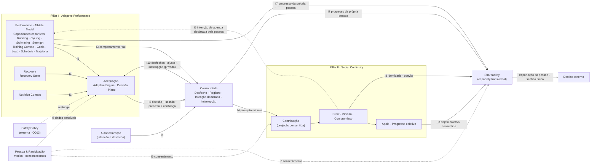
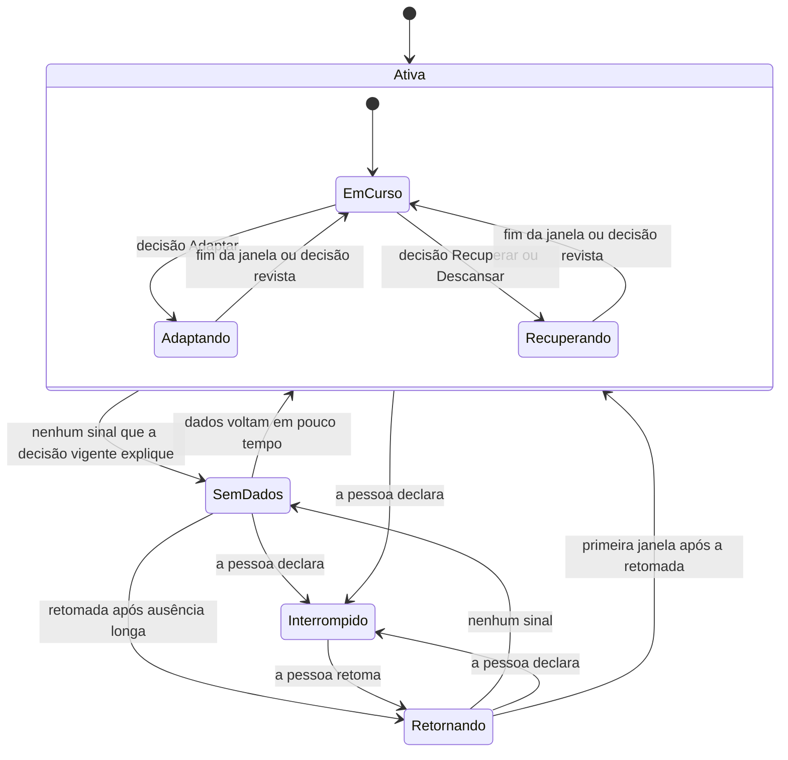

# Vilumo Fit — Product Domain Model

| Campo | Valor |
|---|---|
| Revisão | **PDM-0.6** · 2026-10-11 |
| Linhagem | PDM-0.1 (Architect, traduzia 2.0.0) → PDM-0.2 (Chief, CORRECTION-01: constraints de C023 e Shareability transcritos) → PDM-0.3 (Architect: estrutura de domínio para C023 e Shareability) → PDM-0.4 (Architect). 0.3 → 0.4: correction loop 1 after independent judges → PDM-0.5 (Architect). 0.4 → 0.5: Phase 4 CP-A — aceite do Canon 2.2.0, decisões do Founder da fase 3 e correções carregadas → **PDM-0.6** (Architect). 0.5 → 0.6: Phase 4 CP-B — agente de coordenação como canal de interação, pela decisão do Founder de 2026-10-11 (experiência híbrida) |
| Natureza | Artefato de trabalho: modelo conceitual de domínio. Não canônico. Sem esquema de dados, telas, navegação ou mecânica final (D009 → fase 4). |
| Autoridade | Subordinado a **VILUMO-PTC-2.2.0** (SHA-256 `5c780fdc336166066edbc9ed62dfa0e947efdb5177898faf6c934346f6e35601`), cujo handoff foi aceito em PDR-0.5 §9; consome PTM-0.5. A PDM-0.4 traduzia o 2.1.0 (`4d4ccb65…6dbd1`), agora substituído. Também segue a decisão do Founder de 2026-10-11 sobre experiência híbrida (`audits/founder-decisions/2026-10-11_hybrid-experience-founder-decision.md`, SHA-256 `1db720f2…ef27`), vigente pelo §2 do Canon e em formalização como PTC-2.3.0. Em conflito, prevalece o Canon. |
| Autor (worker) | Product/UX Architect |
| Revisão independente da 0.3 | Relatórios em `audits/phase-1-3-reviews/`. **UX-J** (estrutura do modelo): **FAIL**, com UX-J-01 a UX-J-04 bloqueantes e UX-J-05 a UX-J-12 não bloqueantes · **PCG-J** (ingestão do Canon, conformidade à tese, autoridade): J1, J2 e J3 **PASS**, com PCG-J-01 a PCG-J-12 e rulings J4 · **SEC-J** (fronteiras de informação): **SECURITY_READY_WITH_CONDITIONS**, com SEC-J-01 a SEC-J-15. Resolução por finding: PDR-0.4 §8 |
| Re-revisão do delta 0.4 | Mesmas instâncias, seções finais dos relatórios: **UX-J** Structural **PASS** (UX-J2-01 a UX-J2-07, não bloqueantes) · **PCG-J** J2′ **PASS** (PCG-J2-01 a PCG-J2-06) · **SEC-J** **SECURITY_READY_WITH_CONDITIONS** (SEC-J2-01 a SEC-J2-10, nada bloqueante). Resolução: PDR-0.5 §11 |
| Re-revisão do delta 0.5 | 2026-10-11: **UX-J** Structural **PASS** (UX-J3-01 a UX-J3-05, não bloqueantes) · **PCG-J** **PASS** sobre o Canon 2.2.0 (PCG-J3-01, corrigido na PTM-0.5.1) · **SEC-J** **SECURITY_READY_WITH_CONDITIONS** (SEC-J3-01 a SEC-J3-09, não bloqueantes, com a CP-B como gatilho). Registro: PDR-0.6 §7 e §12 |
| Gate | `DOMAIN_MODEL_APPROVED`: consolidado pelo Chief sobre a PDM-0.5. A 0.6 acrescenta o agente (§2.1, §7, §9) e corrige UX-J3-01 e UX-J3-05 (§6.1, §6.2, §8.1, I9). Essas seções estão no escopo de validade da SEC-J; com o agente, que a re-revisão de 2026-10-11 deixou fora, pedem revisão Security própria, e o agente pede também a do AI Systems. Não se autoaprova. |
| Decisões pendentes | PDR-0.5: FG-2 resolvido (Pacote A; C025) e FG-3 confirmada A; sequencing e launch depth (DR-45) e a forma final de FG-3 vão ao Release Priorities gate, antes da fase 6 (D-CHIEF-02); O013 e O014 abertas (Founder; DR-48, DR-49), sem adoção das soluções dependentes; escopo da CP-B em PDR-0.5 §10 |

**Convenções.** **[C]** obrigação canônica: só texto que o Canon afirma (cita ID ou §) · **LD** leitura derivada: combinação de cláusulas feita pelo Architect, ou interpretação interina do PCG, e não cláusula nova (revisável pelo PCG) · **[P]** proposta do Architect dentro do design space (revisável; não é doutrina) · **[A]** aberto (DR-nn, FG-n ou CPB-nn no PDR-0.5). As leituras registradas no Canon (§7.1, §13 e as do §21.1) têm a autoridade das cláusulas que leem (§2) e entram como [C].
Status de lançamento: **LC** launch-candidate — proposto para o escopo de design desta missão, com confirmação em `RELEASE_SCOPE_APPROVED` (O011) · **DA** direção aceita apenas — não modelada para o lançamento; ponto de extensão (C005, D002) · **RESP** responsabilidade de sistema — não é, por si, objeto de usuário, tela ou destino (§6).
Atributos citados descrevem significado, não campos.

> **Reconciliação 0.3.** Preserva a transcrição da CORRECTION-01 (constraints de C023 e de Shareability) e a converte em estrutura: Capacidades esportivas dentro de Performance (§3.1), Shareability como capability transversal com fronteira interna → externa (§3.2; contratos I7–I9), entidades, estados (§6.9), autoridade, fronteira externa (§8.5), alternativas A6–A8 e cenários S9–S12. O Shareable Object Model completo continua na fase 4 (DR-38).

> **Correção 0.4 (correction loop 1).** Corrige localmente os findings dos três judges sobre a 0.3, sem doutrina nova. Principais mudanças:
> - contrato I10 e fluxos rerroteados: o Plano fica na Adequação, a integração entre domínios também, e a Interrupção é a fonte única da pausa da prática (§3, §3.1);
> - máquina de continuidade aninhada, com regra para descanso não registrado e saída de Retornando para Crew Member (§6.6);
> - Intenção declarada como entidade pessoal (§4);
> - ciclo da Crew com pausas, saídas e destino do compromisso (§6.3, §6.7);
> - rótulos [C], LD e [P] corrigidos;
> - regra de saída de SEC-J-05 (§8.3);
> - estados de recusa, expiração e revogação de shareables (§6.9);
> - cenários X1–X6 (§11).
>
> Resolução por finding: PDR-0.4 §8.

> **Sincronização 0.5 (Phase 4 CP-A).** Traduz o Canon 2.2.0, as decisões do Founder da fase 3 e os findings carregados das re-revisões, sem doutrina nova:
> - fronteira da Crew de C025 com os valores do Pacote A, e criação de Crew como permissão da pessoa (§2.2, §4–§7, §8.2, §8.5);
> - restrições de lançamento do Founder como requisitos de produto (§2.3, §6.1);
> - vocabulário do §7.1: contexto do motor, declaração de suporte, nível transitório e O013 não adotada (§3.1, §4, A6, S10, X4);
> - critério de aderência (I1, I2, §6.4), fontes elegíveis de Contribuição (§6.4, §8.1) e finalidade secundária de I10 com consentimento próprio (I6, I10, A11);
> - rótulos [C] separados de [P] e LD nas arestas proibidas (§1, §9);
> - ciclo de vida do retorno fora de compromisso (§8.3); Interrupção independente do vínculo Pausado (§6.2, §6.6);
> - cenários X7–X11 (§11).
>
> Resolução por item: PDR-0.5 §11. O que é da CP-B está em PDR-0.5 §10 e não é feito aqui.

> **Sincronização 0.6 (Phase 4 CP-B).** Edições pontuais:
> - o agente de coordenação como canal de interação (§2.1, §7, §9), pela decisão do Founder de 2026-10-11 (DR-50);
> - UX-J3-01: a criação de Crew leva o mesmo consentimento informado por Crew do aceite (§6.2, §8.1), e há regra de destino dos dados ao deixar a experiência pessoal (§6.1);
> - UX-J3-05: redação de I9.
>
> Os refinamentos que a arquitetura da CP-B propõe a este modelo ficam para a próxima revisão, depois da revisão independente da arquitetura (DR-54).

## 1. Pilares e relação

| | Pillar I — Adaptive Performance | Pillar II — Social Continuity |
|---|---|---|
| Pergunta | "O que faz sentido eu fazer?" | "Como fazemos para continuar?" |
| Produz | Decisão de Adequação: o comportamento apropriado, com confiança | Continuidade assistida: compromisso, presença, pertencimento, coordenação, apoio, retorno, identidade coletiva (§10) |
| Domínios | Performance (com as Capacidades esportivas de C023), Recovery, Nutrition Context, Adequação | Social Continuity |
| Valor | Appropriate Continuity (C007) | Socially Assisted Continuity (C008) |
| Autonomia | Valor básico sem Crew (L009) | Participação sem adotar o motor (C004, §12) |

**Relação [C L007, L008, §29].** O AP determina o apropriado; o SC favorece que aconteça e continue; o SC nunca altera a decisão. "Decisão apropriada e reconhecimento social precisam ser consistentes" (§29): o reconhecimento deriva da adequação, nunca do volume.

**Primeira classe, estruturalmente [P].** Cada pilar tem domínio(s), outcomes e porta de entrada próprios (Full Member / Crew Member); nenhum é subfunção do outro. Ambos compartilham Pessoa e Continuidade.

**Ponte [P].** Continuidade — "relação no tempo entre intenção, decisão adequada e comportamento real" (§6) — liga os pilares. O SC lê somente a **Contribuição**, projeção mínima e consentida de um Desfecho, nunca o contexto pessoal. No sentido inverso, a Continuidade devolve à Adequação, de forma privada, os desfechos, ajustes e interrupções da própria pessoa (I10). Assim o motor pode re-planejar e re-basear.

**Capability transversal [C C016].** Shareability & Social Projection atravessa os dois pilares sem ser pilar: representa e projeta progresso individual e coletivo já produzido, sempre por escolha da pessoa (§3.2).

**Arestas proibidas** (rótulos separados, PCG-J2-03):
- **[C]** Social → Adequação: prescrever decisão ou carga (§8, L007, L008) · participação em Crew como pré-requisito de valor do AP (L009) · externalizar dado privado de outra pessoa com base no pertencimento à Crew (C021) · objeto interno tornado público por padrão (C017).
- **[P]/LD** Social → Performance, Recovery ou Nutrition como leitura de dados brutos ([P] A1; LD de L014 e §17) · confiança ou verificação de desfecho enviada à Crew (LD de L017) · Shareability lendo dados de origem ([P] DR-44, A8) · projeção externa sem ação da pessoa (LD de C017, de L014 e do "Alcance de VFT-C016").

## 2. Atores e modos de participação

### 2.1 Atores

| Ator | Natureza | Base | Notas |
|---|---|---|---|
| Pessoa (atleta) | Humano; unidade integral | §6, L003 | Pratica uma ou várias modalidades; dona do próprio contexto e dos consentimentos. Adulta: 18+, com idade verificada na entrada (§2.3) |
| Convidado | Humano antes do vínculo | §13, C025 [P] | Recebe convite nominal; não acessa dados da Crew antes de aceitar. O aceite por convite encaminhado ou projetado exige a confirmação de quem convidou (C025), e a entrada passa pela verificação de idade (§2.3) |
| Crew | Coletivo | L011, §6, §14 | Sujeito de identidade coletiva; sem autoridade sobre a adequação de ninguém (§8) |
| Adaptive Engine | Sistema · RESP | §6, L004, L005, L007 | Autoridade de adequação para quem adota a experiência pessoal; "Adaptive Performance Engine" (§8) é a mesma responsabilidade |
| Fontes de dados | Autodeclaração, dispositivos e integrações, derivações | §7, C012 [P] | A tese não define sensores nem integrações (§7); cada sinal carrega confiança. Relógios e outros apps entram só como fontes de dados, via integrações; não são superfícies do produto no lançamento (§2.3) |
| Safety Policy | Autoridade normativa externa ao runtime | C015, O003 | Safety Contract ainda inexistente [A DR-17] |
| Destino externo | Fora do produto: pessoas e plataformas que recebem um objeto projetado | C017, C021 [P] | Nunca recebe objeto interno por padrão; cópias externas ficam fora do controle do produto |
| Agente de coordenação | Sistema · canal de interação da própria pessoa [P] | Decisão do Founder de 2026-10-11 (princípios 4 e 5); L007, L014, L022 | Ajuda a interpretar contexto, resolver conflitos entre modalidades, agenda, recuperação e alimentação, explicar alternativas e preparar ajustes. Não tem autoridade própria: opera pelos contratos existentes (I1–I10), com os consentimentos da pessoa (I6), e a Adequação decide o apropriado (L007). Não guarda estado paralelo: o que muda vai ao objeto de domínio e aparece onde o objeto vive, e as mudanças manuais valem para ele. Não age no social, não consente pela pessoa e não é a identidade do produto (L022). Regras e lacuna de contrato: DR-50, DR-51 |

Não modelados por ausência no Canon: treinador humano, profissional de saúde, moderador, anunciante. Incluí-los exige decisão própria. Menores de 18 anos não são atores do lançamento, por decisão do Founder (§2.3).

### 2.2 Modos de participação

| Modo | Quem | Valor | Regras [C] | Propostas [P] |
|---|---|---|---|---|
| **M1 · Individual sem Crew** | Full Member sem vínculo | AP completo: decisão, progresso, retorno | L009: Crew não é requisito; "sem Crew" é estado pleno | Estímulos sociais e convites a compartilhar nunca condicionam nem degradam valor |
| **M2 · Full Member em Crew** | Full Member com vínculo Ativo ou Pausado | AP + SC | L007, L008: o motor governa; L014: só o consentido cruza | Contribuição projetada do Desfecho (ver §8.1 deste modelo) |
| **M3 · Crew Member** | Pessoa que participa do social sem adotar a experiência pessoal ampla | SC: pertencimento, compromisso, apoio, retorno | C004: fricção muito menor; §12: sem adotar o motor e sem avaliação individual sem contexto | Declara a própria Intenção e o próprio Desfecho de forma estruturada: intenção e categoria do desfecho (SEC-J-07). A Intenção declarada é entidade pessoal de Continuidade (§4). O sistema não julga adequação (DR-03) |

**Direitos de C025 [C §2, §13].** Full Member e Crew Member podem criar uma Crew e participar de mais de uma, até um limite baixo, cujo valor de referência, decidido pelo Founder, está no PDR (FG-2: 3). São possibilidades concedidas a pessoas: o produto deve respeitá-las, e restringi-las exige decisão do Founder. [P] Valem em qualquer modo, inclusive em M1, sem vínculo, porque a criação é permissão da pessoa e não do participante (§8.2; UX-J2-04).

**Assimetria.** [C L010] Os participantes de uma Crew têm "modalidades, níveis, objetivos, volumes e locais diferentes". [P] A participação assimétrica não é um modo: é propriedade da Crew, que mistura M2 e M3; o compromisso é parametrizado por pessoa (§6.7).

**Terminologia [P, DR-01].** "Crew Member" designa somente o papel canônico de participação leve. "Participante da Crew" designa qualquer pessoa com vínculo Ativo ou Pausado, seja Full Member ou Crew Member. A pausa não tira ninguém da Crew, e Convidado não é participante. Rótulos de interface: fase 18.

**Transições.** M1 ↔ M2 ao entrar ou sair de uma Crew, por convite aceito ou criando uma Crew (C025) · M3 → M2 ao adotar a experiência pessoal (D008) · M2 → M3 ao deixar o motor e manter a Crew ([P], D008) · entrada direta em M3 por convite, com fricção muito menor que M1 (C004), ou criando uma Crew ([P] §6.1).

### 2.3 Restrições de lançamento (Founder, fase 3)

Decisões do Founder de escopo de produto e postura legal, não doutrina do Canon (PDR-0.5 §3; DR-47). Fonte: `audits/phase-1-3-reviews/founder-gate-phase3-decisions.md`. São requisitos de produto; não escolhem tela, navegação ou tecnologia.

| Restrição | Decisão do Founder | Requisito de produto [P] | Onde atua |
|---|---|---|---|
| Mercado | Brasil | O produto é concebido para o mercado brasileiro no lançamento. A classificação regulatória dos dados e a base legal seguem o memo do Founder (SEC-J-14) e, até lá, D-CHIEF-03. Preço e moeda não estão decididos (O009) | §8; PDR §7 (SEC-J-14) |
| Idiomas | PT-BR e inglês | Conteúdo e terminologia existem em PT-BR e em inglês desde o lançamento. Nenhum texto, rótulo ou formato (data, número, unidade) fica preso a um idioma, para que outros possam entrar depois, sem retrabalho do modelo. Rótulos e tom: fase 18 | Conteúdo (fase 18); UX Spec (fase 8) |
| Plataformas | iOS e Android | App de smartphone em iOS e Android. Relógios e outros apps entram só como fontes de dados, via integrações (ator Fontes de dados; DR-13), sem superfície própria do produto no lançamento. A estratégia de integração vem depois (fase 22) | §2.1; CP-B (superfícies) |
| Idade mínima | 18+ | Toda pessoa é adulta, com idade verificada na entrada por qualquer caminho: adoção direta, aceite de convite ou criação de Crew. Não há fluxos de menores, nem permissão de responsável, nem proteções específicas para adolescentes. Quem não passa na verificação não entra, e o motivo não é exposto a quem convidou nem à Crew. Mecânica da verificação: CP-B (CPB-11) | §6.1; §8.1; SEC-J2-08 (menores) resolvida por exclusão de escopo |

## 3. Domínios, fronteiras e contratos de integração

Atende C002 (integração de produto com desacoplamento de domínio) e §29 (Performance, Recovery, Nutrition e apoio social distinguíveis). A Shareability é capability transversal (C016), não domínio de pilar.

| Domínio | Responsabilidade | Possui | Não pode | Base |
|---|---|---|---|---|
| **Pessoa & Participação** | Identidade no produto, modo, consentimentos, acesso a capacidades e elegibilidade de entrada (18+; §2.3) | Pessoa, Modo, Consentimento, Acesso a capacidades | Congelar o modo como plano comercial (§6). Regra comercial por papel só por decisão do Founder (O009), aplicada via Acesso a capacidades [P] | §6, §12, §22, L014 |
| **Performance** (Athlete Model) | Contexto de treino da pessoa, com as modalidades de primeira classe: objetivos, agenda, sessões realizadas, carga e trajetória. O contexto integrado (§6) é composto na Adequação [P] | Athlete Model, Capacidades esportivas, Declaração de suporte (catálogo), Leitura de contexto, Prática de modalidade, Training Context, Goals, Load, Schedule, Trajetória | Fragmentar a pessoa por modalidade; usar métrica física comum entre modalidades para contribuição, comparação ou reconhecimento (LD de L018); prescrever ou decidir adequação [P] | L003, L004, C023, §6, §30 |
| **Recovery** | Estado de recuperação e seus sinais | Recovery State, Sinal de recuperação | Diagnosticar; ser contornado pelo motor; ler Performance, porque a integração com a carga ocorre na Adequação [P] | L005, L006, C015, D003 |
| **Nutrition Context** | Contexto alimentar relevante à performance | Nutrition Context | Virar dieta generalista ou terceiro pilar; ler Performance, porque a integração com o treino ocorre na Adequação [P] | C006, L021, §9, D004 |
| **Adequação** (Adaptive Engine) | Integrar o contexto (carga × recuperação, treino × disponibilidade energética) e determinar o comportamento apropriado, inclusive a sessão prescrita | Decisão de Adequação, Plano | Fabricar precisão; aceitar prescrição social; ignorar Recovery; exceder a Safety Policy | L004, L005, L007, L008, C006, C012, C015 |
| **Continuidade** | Intenção → decisão → comportamento real, inclusive interrupção e retorno | Desfecho, Registro de Continuidade, Intenção declarada, Interrupção e Retorno (estados e declarações) | Rotular abandono por falta de dados; expor estados; enviar à Crew intenção ou motivo | §6, C007, L013, §15 |
| **Social Continuity** | Grupos privados e continuidade assistida | Crew, Vínculo, Convite, Compromisso compartilhado, Contribuição, Apoio, Progresso coletivo | Ler contexto pessoal bruto; escrever decisão ou carga; estrutura pública; aceitar entrada sem convite nominal ou, no convite encaminhado ou projetado, sem a confirmação de quem convidou; listar ou buscar Crews publicamente; ingerir contatos (C025, §13) | L010–L012, L014–L017, §8, C025 |
| **Shareability** (capability transversal) | Compor representações compartilháveis a partir de projeções permitidas e projetá-las por ação da pessoa | Objeto compartilhável, Projeção externa | Ler dados de origem ou de outra pessoa; publicar por padrão; virar pilar, feed ou métrica de alcance | C016–C022, §21.1 |

**Transversais [C].** Confiança do dado (C012) em todo sinal e decisão. Consentimento (L014) em toda travessia entre domínios pessoais e o social, e consentimento por finalidade e destino em toda projeção externa (C021).

**Contratos de integração conceituais [P]** — únicos pontos de contato entre domínios:

| # | De → Para | O que cruza | Regra |
|---|---|---|---|
| I1 | Performance (inclusive cada Capacidade esportiva e a Leitura de contexto), Recovery, Nutrition → Adequação | Sinais de contexto com confiança. De cada Capacidade esportiva, também: contribuição de carga da sessão, implicações para recuperação e alimentação, e as estruturas de sessão admissíveis na modalidade, cada uma com seu critério de aderência (UX-J2-01). Capacidade em nível de contexto entrega só carga e implicações, sem estruturas de sessão (§3.1; UX-J2-05) | Dimensão ausente reduz confiança; nunca é preenchida com precisão inventada (C012). Recovery e Nutrition Context não leem Performance: a integração ocorre só na Adequação [P] |
| I2 | Adequação → Continuidade | Decisão de Adequação: tipo, sessão prescrita (quando Executar ou Adaptar) com o critério de aderência que a Capacidade esportiva definiu para ela, confiança, justificativa, validade | Adaptar, recuperar e descansar são decisões plenas, não falhas de executar (LD de L006). A Continuidade classifica o Desfecho com esse critério (§6.4) [P] |
| I3 | Performance (sessões realizadas) e autodeclaração da pessoa → Continuidade | Comportamento real. Do Crew Member, também a Intenção declarada. Do Full Member, também a confirmação de recuperação ou descanso sem sessão | Autodeclaração de Crew Member não é avaliada pelo motor (§12). A do Full Member entra com a confiança correspondente (C012) |
| I4 | Continuidade → Social Continuity | Contribuição: projeção mínima e consentida de um Desfecho de fonte elegível no compromisso (§6.4; UX-J2-02), ou do retorno, por ação da pessoa e para a Crew que ela escolher (SEC-J2-06) | Sem contexto, motivo, intenção, confiança, verificação, fonte ou modo de participação (L014, L017, §11; SEC-J-07) |
| I5 | Social Continuity → Performance (Schedule) | Intenção de agenda declarada pela própria pessoa (ex.: sessão combinada) | Entra como contexto; o motor decide a adequação (L007, L008). Ativado só com Together (DA, DR-37) |
| I6 | Pessoa & Participação → I1 e I10 (dados sensíveis), I4, I5, I7–I9 e persistência social | Consentimentos vigentes: por finalidade, por escopo de Crew e, na projeção externa, por destino. Para dados sensíveis, explícitos e específicos (D-CHIEF-03). Inclui o consentimento próprio da finalidade secundária de I10 (dinâmica comportamental, C009), desligado por padrão e revogável (PCG-J2-01, SEC-J2-02) | Sem consentimento, nada cruza (L014, C021). Sem consentimento explícito, o dado sensível não é coletado nem usado, e o motor opera com confiança reduzida (C012) [P] |
| I7 | Continuidade ou Performance → Shareability | Progresso da própria pessoa, por iniciativa dela. De Continuidade: desfechos, retorno, marcos de continuidade e progresso do período. De Performance: resultado de sessão, objetivo alcançado, momentos de performance e progresso multiesporte | Nunca dado de outra pessoa; representação sem premiar volume (C018). Recovery, Nutrition e composição corporal não são fonte no modelo atual: incluí-los é decisão do DR-38 com Security (D-CHIEF-03) [P] |
| I8 | Social Continuity → Shareability | Objeto coletivo da Crew: identidade, compromisso concluído, progresso coletivo e convite; objetos de conceitos DA quando entrarem, com revisão Security na entrada (SEC-J2-10; CPB-09) | Só dados consentidos pelos membros identificáveis ou agregados não reidentificáveis (C021 e sua leitura); sem revelar quem não contribuiu (L017). O convite não leva dados de participantes (SEC-J-12) e [C C025] nunca inscreve ninguém por si: o aceite por convite projetado exige a confirmação de quem convidou |
| I9 | Shareability → Destino externo | Objeto composto pela pessoa | Por ação explícita da pessoa, com consentimento por finalidade e destino; nunca por padrão (C017). A cópia externa é irrevogável, e isso é informado antes [P]. Sentido único: alcance, curtidas, seguidores ou reações externos nunca voltam ao produto (LD, R-A8; C022, L020), nem retorno de conversão ou atribuição, como quem viu, clicou ou entrou a partir de um objeto ([P] SEC-J2-05). O único caminho de entrada a partir de um objeto projetado é o aceite de convite, sob a confirmação de C025; a adoção direta (M1) e a criação de Crew seguem como entradas próprias (UX-J3-05) |
| I10 | Continuidade → Adequação | Da própria pessoa com Athlete Model: Desfechos, motivo de ajuste (se ela informar), Interrupção e retomada declaradas | Privado: nunca segue para Social Continuity ou Shareability. O motivo é opcional e nunca exigido (§11). Finalidade primária: re-planejar e re-basear as Decisões da própria pessoa (L007, L013). Finalidade secundária, a dinâmica comportamental da própria pessoa (C009): só com consentimento próprio por finalidade via I6, desligado por padrão e revogável; sem ele, I10 serve só à primária (§16, §24; PCG-J2-01, SEC-J2-02). Motivos nunca alimentam Social Support Profile, Social Performance Graph ou personalização social sem O007 resolvida e consentimento específico, e sua retenção é limitada (§8.3). Sem inferência psicológica ou de vulnerabilidade como fato (§16) e sem diagnóstico (C015) [P] |

**Teste de desacoplamento [P].** Cada domínio pode mudar seu mecanismo interno sem alterar I1–I10: representação de Recovery (D003), profundidade de Nutrition (D004), mecânicas sociais (D002), profundidade de cada modalidade (L023) ou formatos compartilháveis (D010).
- **Exceção explícita.** Tornar Recovery, Nutrition ou composição corporal fonte de shareable altera I7 e exige Security (DR-38, DR-44).
- **Sem contrato Adequação → Performance.** A prescrição pertence à Adequação e segue por I2. Performance registra o realizado (I3) e o que a pessoa declara (Schedule).
- **Social.** Depende só de Pessoa & Participação e de I4 (I5 opcional). Isso preserva a opcionalidade do §29 sem autorizar separação (C001, O010).
- **Shareability.** Depende só de I6, I7 e I8.

### 3.1 Domínios esportivos de primeira classe (C023)

**[C]** Running / Corrida, Cycling / Ciclismo, Swimming / Natação e Strength Training / Musculação / Força / Fortalecimento são domínios de primeira classe mínimos (C023), dentro da pessoa integral (L003). Usar uma modalidade como contexto do motor não é declarar suporte (§7.1); para as de C023, o nível de contexto transitório, com prazo no Release Scope vigente, não viola C023 (§7.1). L023 exige profundidade crível para declarar suporte pleno. O Release Scope define sequencing, launch depth, ordem de dependência, cobertura mínima crível e profundidade progressiva (C024, §7.1), sem placeholder, tracking genérico sem credibilidade nem promessa de suporte completo antes da profundidade (C024). D011 conserva outros esportes abertos. As responsabilidades esportivas "não impõem uma tela, módulo ou métrica universal por esporte" (§30).

**[P, DR-42] Capacidade esportiva.** Dentro de Performance, cada modalidade de primeira classe é uma Capacidade esportiva: responsabilidade pelo que é específico da modalidade, que entrega ao Athlete Model uma leitura comum. Nenhuma capacidade decide adequação sozinha nem mantém pessoa, plano ou carga paralelos.

| Específico de cada Capacidade esportiva | Compartilhado (Athlete Model, Adequação, Continuidade) |
|---|---|
| Representação de workout, estrutura de sessão e estruturas de sessão admissíveis na modalidade, oferecidas à Adequação via I1, cada uma com seu critério de aderência | A pessoa, seus objetivos e a prioridade entre modalidades |
| Medidas de intensidade e métricas próprias da modalidade | Carga total e interferência entre modalidades (Load); Plano e sessão prescrita (Adequação) |
| Contribuição da sessão para a carga, com confiança | Recovery State, um por pessoa com Athlete Model |
| Implicações da modalidade para recuperação e alimentação, entregues à Adequação via I1, onde são integradas a Recovery State e Nutrition Context | Nutrition Context, um por pessoa com Athlete Model |
| Fatos de perfil e onboarding próprios da modalidade (ex.: experiência na modalidade) | Schedule & Disponibilidade |
| Critério de profundidade crível da modalidade (DR-20; quem o fixa e quem verifica: O014) | Decisão de Adequação, Desfecho, Contribuição e shareables |

- [C L003, L004] A Adequação coordena todas as modalidades praticadas; uma Capacidade esportiva informa, não decide.
- LD (L018, §30; O008): nenhuma métrica física comum entre modalidades serve à contribuição social, à comparação ou ao reconhecimento. Entre modalidades, compara-se adequação, nunca unidade física. A carga integrada entre modalidades (Load, L004) é representação interna do motor, com confiança, e não métrica de comparação.
- [P] **Leitura comum.** Todas as capacidades entregam a mesma leitura via I1: contribuição de carga com confiança, implicações para recuperação e alimentação, e estruturas de sessão admissíveis, cada uma com seu critério de aderência. Em nível de contexto, a capacidade entrega só carga e implicações (abaixo). Acrescentar uma modalidade (D011) é acrescentar uma capacidade, sem alterar I1–I10.
- [P] **Integração.** A Adequação é o único ponto onde se combinam carga × recuperação e treino × disponibilidade energética (C006). Recovery e Nutrition Context não leem Performance.
- [P] **Prescrição.** A Adequação compõe a sessão prescrita e o Plano na representação da Capacidade esportiva correspondente. Não há contrato Adequação → Performance: a prescrição segue por I2, e Training Context guarda só o realizado.
- [P] **Critério de aderência (UX-J2-01).** Cada Capacidade esportiva define o critério de aderência das estruturas de sessão que oferece. A Adequação o carrega com a sessão prescrita (I2), e a Continuidade classifica o Desfecho com ele (§6.4). O critério cobre conclusão parcial e janelas com várias sessões e nunca favorece volume (L008, §6). Mecânica: fase 5, com DR-20.
- [P] **Declaração de suporte.** Fica no catálogo do produto, por modalidade, e não na Prática da pessoa. Dois estados, no vocabulário do §7.1:
  - **plenamente suportada:** declarada no Release Scope vigente, com os critérios de cobertura mínima crível atendidos (L023; quem os fixa e quem verifica: O014);
  - **não declarada (só contexto do motor):** a atividade informa o motor (carga, recuperação, interferência, disponibilidade) com confiança explícita, sem nenhum meio de declarar suporte: sem listagem, placeholder ou anúncio, plano, prescrição ou analytics próprios (§7.1). Para modalidade de C023, é o nível de contexto transitório e registra o prazo do Release Scope vigente; sem prazo, a partir do primeiro Release Scope, é estado final, que exige decisão explícita do Founder sobre aquela modalidade (§7.1).

  Não há terceiro estado: a representação de suporte limitado (ex.: analytics próprios antes de planos, listagem "beta") é O013, aberta, e o modelo não a adota (§32 do Canon). [C §7.1] Declarar uma modalidade plenamente suportada num release é decisão de Release Scope: Product/UX propõe, e o Founder decide quais modalidades são declaradas plenamente suportadas. [C C024] Para as modalidades de C023, durante o faseamento, nunca há placeholder, tracking genérico sem credibilidade ou promessa de suporte completo antes da profundidade. LD (§7.1): para as de D011, essas representações caem em L023 ou em O013, e o modelo não as adota.
- [P] **Caminhos de leitura.** São design space de Product/UX (D009, DR-42), sem dependência de doutrina (PCG-J2-04).
  - Modalidade adicional sem capacidade (D011): **Leitura de contexto** (§4). [C §7.1] A atividade informa o motor como a de qualquer outra; Product/UX escolhe como ela é lida, não se ela informa carga e recuperação.
  - Modalidade de C023 no nível de contexto transitório: a própria Capacidade esportiva, em profundidade parcial. Nunca o caminho genérico: é a escolha mais protetora contra tracking genérico sem credibilidade (C024).
  - LD (§7.1, C024; O013 aberta), UX-J2-05: **em nível de contexto, a capacidade entrega só carga e implicações** para recuperação e alimentação, sem estruturas de sessão. Logo, nenhuma Decisão prescreve sessão nessa modalidade: oferecer prescrição própria é meio de declarar suporte (§7.1), e a representação limitada não está decidida (O013).
- **[C §7.1, C024] Formalizado no Canon 2.2.0** (antes, leitura interina R-DR-43; PDR-0.5 §6):
  1. Uso como contexto do motor não é declaração de suporte; pode-se informar que a sessão foi considerada para carga e recuperação.
  2. A confiança é explícita. Dado que não pode ser lido de forma crível recebe confiança reduzida explícita, sem precisão fabricada nem omissão silenciosa (C012).
  3. Para C023, o nível de contexto transitório exige prazo, em release ou data, no Release Scope vigente. Sem prazo, a partir do primeiro Release Scope, é estado final abaixo da cobertura e exige nova decisão explícita do Founder sobre aquela modalidade, que PCG registra como revisão de C023. Aprovar um Release Scope não equivale a essa decisão.
  4. Representações vedadas no faseamento (C024): placeholder, tracking genérico sem credibilidade e promessa de suporte completo antes da profundidade, qualquer que seja o nível representado. A representação de suporte limitado segue O013 e não é adotada.
- **D-CHIEF-02.** As fases 4–5 ficam estruturadas por Capacidade esportiva, sem detalhe de fluxo por modalidade. Sequencing e launch depth (DR-45) são decididos no Release Priorities gate, antes da fase 6.
- Athlete Model, Training Context, Goals, Load, Recovery e Nutrition Context respeitam esses domínios quando especificados, sem congelar métricas ou schemas agora; mecânicas por modalidade ficam para as fases 5–8, com evidência (DR-20).

### 3.2 Shareability & Social Projection (capability transversal)

**[C]** Capability transversal, sem terceiro pilar nem domínio de audiência (C016); "o produto deve possuir uma camada forte de compartilhamento de progresso individual e social/coletivo" (C016); "Vilumo deve transformar resultados, metas, streaks contextuais, campanhas, conquistas e identidade social em objetos visualmente desejáveis e externamente compartilháveis, quando apropriado" (§21.1, "Alcance de VFT-C016": a obrigação recai sobre a capability, e quais objetos existem e quando são lançados permanece em D010; "campanhas" é ilustrativo, pela leitura de C016); voluntária e nunca requisito para valor, reconhecimento ou participação (§21.1); parte da arquitetura dos objetos e da representação do progresso, não exportação de tela (C017); objeto interno não se torna público por padrão (C017); consentimento por finalidade e destino; pertencer à Crew não autoriza externalizar dados privados de terceiros; coletivos agregados e/ou consentidos, sem reidentificação nem exposição por inferência (C021); sem vanity drift (C022). O SHAREABLE OBJECT MODEL completo é trabalho da fase 4, na CP-B (C026; DR-38), e o sistema visual é downstream (C027; DR-39); a ontologia de objetos permanece aberta (D010). Pela leitura de C016, "quando apropriado" tem condições mínimas necessárias, não suficientes: ser compatível com a determinação do motor, sem tornar adaptação, recuperação, descanso ou retorno menos legítimos; ser voluntário e consentido para a finalidade e o destino; e não converter o produto em audiência, posting ou competição por volume. Os critérios concretos pertencem ao Shareable Object Model (C026). LD: "forte" qualifica a capability e não fixa os objetos do primeiro release (C019; DR-46).

**[P, DR-44] Fronteira.** A Shareability não possui dados de origem. Ela compõe representações a partir de projeções que os domínios donos já permitem:
- progresso da própria pessoa, vindo de Continuidade e de Performance (I7);
- objetos coletivos da Crew, inclusive o convite (I8).

Ela só entrega essas representações a um destino externo por ação da própria pessoa (I9), em sentido único: nada externo volta ao produto (LD, R-A8), nem conversão ou atribuição ([P] SEC-J2-05). Regras da fronteira:
- Não lê Recovery, Nutrition ou Performance brutos, nem dados de outra pessoa.
- Dados sensíveis da própria pessoa (Recovery, Nutrition, composição corporal) não são fonte no modelo atual. Incluí-los é decisão do DR-38 com Security (D-CHIEF-03).
- Em Crew pequena, objetos coletivos exigem consentimento dos membros identificáveis; agregação sozinha não basta (PTM N9). [C §21.1, leitura de C021] Mostrar um membro com o próprio consentimento dele, para aqueles dados, finalidade e destino, não é reidentificação, e nenhum consentimento autoriza revelar dados ou a não participação de outro membro. LD: com C025 e o valor de referência de até cerca de 8, o caminho agregado tende a não existir. Regra concreta: SEC-J-10, na CP-B (CPB-01).
- [C C025] O objeto de convite projetado nunca inscreve ninguém por si: o aceite por convite projetado ou encaminhado exige a confirmação de quem convidou. Ciclo de vida do convite: CP-B (SEC-J-03, SEC-J-12; CPB-02).

Esta seção define a fronteira, não entidades finais, templates ou controles técnicos.

## 4. Entidades conceituais

| Entidade | Domínio | Significado | Base | Status |
|---|---|---|---|---|
| Pessoa | Pessoa & Participação | Unidade integral; uma identidade de produto para os dois pilares; adulta (18+), com idade verificada na entrada (§2.3) [P] | §6, L003, C001; DR-47 | LC |
| Modo de participação | Pessoa & Participação | Full Member ou Crew Member; papel, não plano; 0..1 vigente (§5) | C004, §6 | LC |
| Consentimento | Pessoa & Participação | Autorização da pessoa por categoria de informação, finalidade, escopo e, na projeção externa, destino. O escopo é cada Crew, quando a informação é social (SEC-J-01). Para dados sensíveis, o consentimento é explícito e específico (D-CHIEF-03). Inclui a finalidade secundária de I10 (C009), desligada por padrão. Revogável para o futuro [P granularidade] | L014, §16, §17, §24, C021 | LC |
| Acesso a capacidades | Pessoa & Participação | O que a pessoa pode usar; separado do modo; nenhuma regra comercial assumida [P] | §6, §12, §22; O005, O009 | LC (seam) |
| Athlete Model | Performance | Responsabilidade de compreender a pessoa integral ao longo do tempo; existe para quem adota a experiência pessoal | §6, L003, C009 | RESP · LC |
| Capacidade esportiva (Running · Cycling · Swimming · Strength Training) | Performance | Responsabilidade pelo que é específico da modalidade. Entrega à Adequação, via I1, a leitura comum e as estruturas de sessão admissíveis, com o critério de aderência de cada uma; em nível de contexto, só carga e implicações (§3.1) [P fronteira] | C023, C024, L003, L023, §30 | RESP · LC (conjunto mínimo; sequencing e launch depth: DR-45, §7.1) |
| Declaração de suporte | Performance (catálogo do produto; não é dado pessoal) | Estado vigente de cada modalidade: **plenamente suportada** ou **não declarada (só contexto do motor)**. Para modalidade de C023 não declarada, o prazo registrado no Release Scope vigente. Sem estado de suporte limitado (O013). Decidido em Release Scope (§3.1) [P] | L023, C023, C024, D011, §7.1 | LC |
| Leitura de contexto | Performance | Caminho de leitura de sessões de modalidade adicional sem Capacidade esportiva. Produz carga e implicações com confiança explícita, sem métricas próprias, plano ou apresentação como suporte. Não se aplica às quatro de C023 (§3.1) [P] | D011, C012, L003, L004, §7.1 | RESP · LC |
| Prática de modalidade | Performance | Modalidade praticada pela pessoa. O nível de suporte é o da Declaração de suporte, não da pessoa [P] | L003, C023, D011 | LC |
| Training Context (Sessão realizada) | Performance | Treino realizado em qualquer modalidade, lido pela Capacidade esportiva correspondente ou pela Leitura de contexto. A sessão prescrita pertence à Adequação [P] | L003, L004, C023 | LC |
| Goals (Objetivo) | Performance | O que a pessoa busca; informa a adequação. O objetivo alcançado é marco de performance, de Goals [P] | L004, §6; [A DR-15] | LC |
| Schedule (Agenda & Disponibilidade) | Performance | Quando e quanto a pessoa pode treinar enquanto pratica, inclusive sessões que ela declara pretender fazer (ex.: sessão combinada via I5). Pausar a prática é Interrupção, em Continuidade, não Schedule [P] | L004 | LC |
| Load (Carga) | Performance | Derivada de todas as sessões realizadas, considerando interferência entre modalidades, com confiança. Representação interna, não métrica de comparação (LD de L018). Fórmula não definida | L004, §6, C012 | LC |
| Trajetória | Performance | Direção longitudinal de performance da pessoa (objetivos, carga e capacidade ao longo do tempo), inclusive o progresso multiesporte. Não registra adequação nem desfechos: isso é o Registro de Continuidade [P] | L004, C009, §24 | LC |
| Recovery State | Recovery | Estado de recuperação usado pelo motor | L005, L006 | RESP · LC |
| Sinal de recuperação | Recovery | Evidência autodeclarada, de dispositivo ou derivada de outros sinais de recuperação, com confiança. Dado sensível (D-CHIEF-03) | D003, C012, C015 | LC |
| Nutrition Context | Nutrition Context | Contexto alimentar suficiente para as áreas do C006, no nível que os objetivos suportados exigem. Dado sensível, inclusive composição corporal (D-CHIEF-03) | C006, L021; [A O004, DR-18] | LC (mínimo C006) |
| Adaptive Engine | Adequação | Determina o comportamento apropriado sob a Safety Policy | L004, L005, L007; [A O003] | RESP · LC |
| Decisão de Adequação | Adequação | Comportamento apropriado para uma janela, integrado entre as modalidades: Executar · Adaptar (reduzir ou substituir) · Recuperar · Descansar · Retornar. Inclui a sessão prescrita quando Executar ou Adaptar, a confiança, uma justificativa compreensível e a validade | §6, L006, C012, C015 | LC |
| Plano | Adequação | Horizonte previsto de Decisões, revisável a cada janela e a partir dos desfechos (I10). Composto na representação de cada Capacidade esportiva plenamente suportada. Forma e horizonte: fases 5–8 (DR-20) [P] | L004, L007, C023, L023 | LC |
| Confiança do dado | Transversal | Qualidade, frescor, completude e conflito dos sinais e da decisão | C012 | LC |
| Intenção declarada | Continuidade | O que o Crew Member declara pretender para um período, de forma estruturada; é a referência pessoal do seu Desfecho. Há uma vigente por pessoa e período, comum a todos os seus vínculos. Não pertence a um compromisso e não é avaliada pelo sistema. É a referência da falta de dados do Crew Member (§6.6) [P] | §6, §12, C004 | LC |
| Desfecho | Continuidade | O que aconteceu frente à Decisão (Full Member) ou à Intenção declarada (Crew Member). A Continuidade o classifica; para Full Member, com o critério de aderência carregado com a sessão prescrita (§6.4) | §6 [P categorias e classificação, §6.4] | LC |
| Registro de Continuidade | Continuidade | Série de desfechos e estados da pessoa, com marcos de continuidade (ex.: retorno após interrupção). É a base de Appropriate Continuity [P marcos] | C007, L013 | LC |
| Interrupção / Retorno | Continuidade | Pausa da prática declarada pela pessoa, que é a fonte única da indisponibilidade que suspende a prática (§6.6), e retomada ajustada ao contexto atual. Independe do vínculo Pausado (§6.2) | L013, §15 | LC |
| Crew | Social Continuity | Pequeno grupo privado com relação real e identidade coletiva, da ordem de um círculo íntimo: até cerca de 8 participantes, valor de referência do Founder (PDR FG-2). Sem listagem nem busca pública; nome final aberto | L011, C025, C005, §14; D001 | LC |
| Vínculo (Crew Membership) | Social Continuity | Relação pessoa–Crew, com estados próprios (§6.2). Ativo e Pausado contam como participante. Uma pessoa tem até 3 vínculos de participante, valor de referência do Founder (PDR FG-2) [P contagem] | C025, L011 | LC |
| Convite | Social Continuity | Convite nominal de um participante a uma pessoa, para uma Crew: é o critério de relação real. O aceite por convite encaminhado ou projetado exige a confirmação de quem convidou, e o objeto de convite projetável nunca inscreve ninguém por si. Procedimento: DR-33; ciclo de vida: CP-B (SEC-J-03, SEC-J-12; CPB-02) | C025, §13, C003; [A DR-33] | LC |
| Compromisso compartilhado | Social Continuity | Compromisso da Crew para um período; a parte de cada pessoa é o que faz sentido para ela [P mínimo na direção Pact/Mission] | C005, D002; [A FG-3] | LC |
| Contribuição | Social Continuity | Projeção mínima e consentida de um Desfecho de fonte elegível no compromisso (§6.4). Por ação da pessoa, também do seu retorno, para a Crew que ela escolher, mesmo sem compromisso ativo; o retorno fora de compromisso tem ciclo de vida limitado (§8.3). Tem o mesmo significado entre fontes elegíveis (SEC-J-07; UX-J2-02) [P] | L010, §11, L014 | LC |
| Apoio | Social Continuity | Gesto de encorajamento entre participantes [P] | §10, L017; [A DR-30] | LC |
| Progresso coletivo | Social Continuity | Representação não física da continuidade da Crew no compromisso | L010, §14; [A O008, DR-06] | LC |
| Objeto compartilhável | Shareability | Representação de progresso individual ou coletivo, derivada de projeções permitidas; privada até a pessoa projetá-la (§6.9) [P] | C016–C021, D010 | LC (capability); objetos específicos: DR-38, DR-46 |
| Projeção externa | Shareability | Entrega de um objeto a um destino externo, por ação da pessoa e com consentimento por finalidade e destino [P] | C017, C021 | LC (capability) |
| Season · Together · Rally · Moments · Mission e Pact além do mínimo | Social Continuity | Direções aceitas; nomes e mecânicas abertos | C005, D002 | DA |
| Crew Memory | Social Continuity | Memória social além da retenção operacional | C005, §14, O007 | DA |
| Social Support Profile · Social Performance Graph | Social Continuity | Personalização do apoio; compreensão de relações de apoio, nunca follower graph | C005, D005, §13, §16, O007 | DA |
| Competição | Social Continuity | Formato competitivo no modelo fechado | D006, L018; O008 | Design space, não LC |
| Badges, streaks contextuais, celebrações, recompensas | Transversal (experiência) | Mecânicas de reconhecimento | D007, L019 | Design space (fase 5) |

**Leitura do conjunto LC [P, DR-11].** O conjunto social LC é o mínimo que torna representáveis os seis outcomes do §30: valor sem Crew, entrada leve, contribuição assimétrica, recuperação correta, interrupção e retorno (inclusive o retorno compartilhado com a Crew) e apoio consentido.
- As quatro Capacidades esportivas são LC por C023, com profundidade e sequência definidas em DR-45.
- A capability de Shareability é LC por C016 e C017, com objetos de lançamento definidos em DR-46.
- LC não é obrigação de lançamento. A forma final é decidida no Release Priorities gate (O011; D-CHIEF-02). O Founder confirmou a opção A de FG-3 como base de trabalho das fases 4–6 (2026-10-10). [C §7.1] Adiar um conceito aceito é prioridade de lançamento (O011, D002); abandoná-lo de vez ou redefini-lo é mudança material de direção (O012).
- Conceitos DA permanecem válidos e entram por decisão posterior, sem alterar I1–I10.

## 5. Relacionamentos

- Pessoa — 0..1 Modo vigente [P]. Não há modo depois de sair da última Crew sem adotar a experiência pessoal (§6.1).
- Pessoa — 0..1 Athlete Model [P]: 1 para Full Member; 0 para Crew Member (A3).
- Athlete Model — N Práticas de modalidade · N Goals · 1 Schedule · N Sessões realizadas (Training Context). Load e Trajetória derivam das Sessões realizadas de **todas** as modalidades [C L003, L004].
- Performance — 4 Capacidades esportivas de C023, mais as adicionais que o Release Scope incluir (D011); 1 Declaração de suporte vigente por modalidade [P].
- Sessão realizada — pertence a uma modalidade. É lida pela capacidade correspondente ou, se não houver capacidade, pela Leitura de contexto [P].
- Pessoa com Athlete Model — 1 Recovery State (no tempo) · 1 Nutrition Context [C L005, C006].
- Crew Member — 0 Recovery State e 0 Nutrition Context: sem motor, esses dados não teriam consumidor nem finalidade. Ao adotar a experiência pessoal, a pessoa passa a Full Member e ganha 1 de cada. Base: minimização (L014, §16, §27) e D-CHIEF-03 [P] (UX-J2-06).
- Adaptive Engine — emite 1 Decisão integrada por Pessoa e janela, cobrindo todas as modalidades praticadas, e N ao longo do tempo. O Plano é a sequência prevista dessas Decisões [P].
- Decisão — 0..1 Desfecho: nenhum quando revista ou encerrada por Interrupção declarada. Os Desfechos compõem o Registro de Continuidade.
- Pessoa (Crew Member) — 0..1 Intenção declarada vigente por período, comum a todos os seus vínculos [P].
- Pessoa N — M Crew, via Vínculo: até 3 vínculos de participante (Ativo ou Pausado) por pessoa; Crew com até cerca de 8 participantes. São os valores de referência do Founder (PDR FG-2; C025). A contagem exata e a aplicação dos tetos (convites pendentes, aceites simultâneos) ficam na CP-B (CPB-07) [P].
- Pessoa — cria 0..N Crews, dentro do limite de vínculos; quem cria é o primeiro participante (C025) [P].
- Crew — 0..1 Compromisso ativo; compromissos encerrados seguem a retenção de §8.3 (DR-14) [P].
- Compromisso — N Contribuições, por participante aderente e janela. Cada Contribuição projeta 1 Desfecho via I4 [P].
- Crew — N Contribuições de retorno, por ação da pessoa, com ou sem compromisso ativo; fora de compromisso, com ciclo de vida limitado (§8.3) [P].
- Apoio — de um participante a outro, ligado a uma Contribuição, inclusive de retorno [P].
- Convite — nominal, de um participante a uma pessoa, para uma Crew (C025). O aceite por convite encaminhado ou projetado só vale com a confirmação de quem convidou; procedimento em DR-33.
- Sessão combinada (Together, DA) → I5 → Schedule da pessoa, somente se ela declarar a intenção [P].
- Objeto compartilhável — deriva do progresso da própria pessoa (I7: Continuidade ou Performance) ou de um objeto coletivo da Crew, inclusive o convite (I8). Tem 0..N Projeções externas, cada uma com consentimento próprio [P].

## 6. Ciclos de vida e estados

### 6.1 Participação da pessoa

| De | Para | Gatilho | Regra |
|---|---|---|---|
| — | Full Member (M1) | Adota a experiência pessoal | Valor individual sem Crew (L009). Idade verificada na entrada: 18+ (§2.3) |
| Convidado | Crew Member (M3) | Aceita convite com preparação mínima | Fricção muito menor que adotar a experiência pessoal (C004). No convite encaminhado ou projetado, só com a confirmação de quem convidou (C025). Idade verificada na entrada (§2.3) |
| Full Member sem vínculo (M1) | Full Member em Crew (M2) | Cria uma Crew | [C C025] Direito da pessoa. [P] Ela é o primeiro participante, e a Crew nasce Em formação (§6.3) |
| Pessoa sem modo vigente, inclusive quem ainda não entrou | Crew Member (M3) | Cria uma Crew sem adotar a experiência pessoal | [C C025] Qualquer pessoa pode criar. [P] O direito não depende de vínculo vigente; idade verificada na entrada (§2.3); mecânica de entrada na CP-B (D008) |
| — | Fora do produto | Não passa na verificação de idade (18+) | Sem fluxo de menores (§2.3). [P] O motivo não é exposto a quem convidou nem à Crew |
| Crew Member | Full Member | Adota a experiência pessoal | Evolução é design space (D008); nunca condição para permanecer na Crew |
| Full Member | Crew Member | Deixa a experiência pessoal e mantém a Crew | [P], D008; destino dos dados abaixo |
| Full Member sem vínculo (M1) | — (sem modo vigente) | Deixa a experiência pessoal | [P] Mantém conta sem modo; destino dos dados abaixo (UX-J3-01) |
| Crew Member sem vínculo | — | Sai da última Crew (não resta vínculo Ativo nem Pausado) | Mantém conta sem modo ativo; pode reentrar por convite, criar uma Crew (C025) ou adotar a experiência pessoal [P] |
| Qualquer | Fora do produto | Encerra a conta | Retenção e eliminação no contrato de privacidade (fase 22, Security) [A] |

[P] **Deixar a experiência pessoal (UX-J3-01).** Quando um Full Member passa a Crew Member, ou deixa a experiência pessoal sem Crew e fica sem modo vigente, Athlete Model, Recovery State, Nutrition Context, Plano e os dados da finalidade secundária de I10 são eliminados ou retidos só nos termos do contrato de privacidade. O Registro de Continuidade é mantido. Durações: CPB-08 e fase 22 (Security).

### 6.2 Vínculo com a Crew

| Estado | Entra por | O que a Crew vê | Regras |
|---|---|---|---|
| Convidado | Convite emitido | Nada além do previsto em §8.1 | Não é participante; não vê dados da Crew. Ciclo de vida do convite (expiração, revogação, recusa): CP-B (SEC-J-03, SEC-J-12; CPB-02) |
| Ativo | Aceite do convite nominal ou criação da Crew (C025), nos dois casos com o mesmo consentimento informado, por Crew (§8.1; mecânica em CPB-03; UX-J3-01). No convite encaminhado ou projetado, só com a confirmação de quem convidou (C025); dentro do limite de 3 vínculos (PDR FG-2) | Nome de exibição e Contribuições consentidas | É participante; pode pausar ou sair a qualquer momento, sem penalidade (L017) |
| Pausado | Decisão da pessoa, por Crew | "Em pausa", sem motivo, horário, histórico ou frequência de pausas (SEC-J2-06) | Continua participante. Nenhuma Contribuição é projetada e não há marcação de ausência. Não altera o estado da Crew nem o compromisso dos demais (§6.3). Volta a Ativo quando quiser (L013, §15). Independe da Interrupção da prática (abaixo) |
| Saiu | Decisão da pessoa, encerramento da Crew ou remoção, cujo mecanismo é da CP-B (SEC-J-04, DR-33; CPB-04) | Nada novo | Deixa de ser participante. O acesso ao conteúdo da Crew, inclusive o histórico, termina na saída [P; regra completa em SEC-J-04]. Contribuições e Apoios seguem §8.3. Reentrada só por novo convite |

[P] **Interrupção e vínculo Pausado são independentes (UX-J2-07).** A Interrupção é estado da prática pessoal (Continuidade, §6.6); o vínculo Pausado é estado da relação com uma Crew (Social Continuity). Declarar uma interrupção não pausa vínculos, e pausar um vínculo não interrompe a prática. Nenhum dos dois é exposto por causa do outro (L014, L017). Se a declaração de interrupção pode oferecer pausar vínculos sem exposição é questão da CP-B (CPB-10); os rótulos ficam para a fase 18.

### 6.3 Crew

Participante = vínculo Ativo ou Pausado (§6.2). Pausas não mudam o estado da Crew [P]. Tamanho: até cerca de 8 participantes, valor de referência do Founder (PDR FG-2; C025).

| Estado | Condição | Regras |
|---|---|---|
| Em formação | Menos de 2 participantes: recém-criada, ou reduzida a 1 por saídas | Sem compromisso ativo [P] |
| Ativa | 2 ou mais participantes, até o teto de referência | 0..1 compromisso ativo [P] |
| Encerrada | Decisão dos participantes (procedimento em DR-33) ou saída do último participante | Sem rótulo de fracasso; retenção conforme §8.3 (DR-14) |

| De | Para | Gatilho | Efeito sobre o compromisso [P] |
|---|---|---|---|
| — | Em formação | Uma pessoa cria a Crew (C025) e é o primeiro participante | — |
| Em formação | Ativa | Um convidado aceita e a Crew passa a ter 2 participantes | — |
| Ativa | Em formação | Saídas deixam 1 participante | Compromisso ativo → Cancelado, sem rótulo de fracasso |
| Ativa ou Em formação | Encerrada | Decisão dos participantes (DR-33) | Compromisso ativo → Cancelado, sem rótulo de fracasso |
| Em formação | Encerrada | Sai o último participante | — (não há compromisso ativo) |

- Uma saída que mantém 2 ou mais participantes não muda o estado da Crew; o compromisso segue para quem permanece (§6.7).
- Não existe estado "Crew inativa" ou "fracassada" exposto como falha (L013, L017). Crew sem compromisso ativo é apenas Ativa.
- [C C025] Qualquer pessoa, Full Member ou Crew Member, pode criar uma Crew. [P] É permissão da pessoa (§8.2); quem cria é o primeiro participante, e a Crew nasce Em formação.

### 6.4 Decisão de Adequação (Full Member)

Ciclo da decisão [P]:
1. **Emitida:** tipo, sessão prescrita (quando Executar ou Adaptar), confiança, justificativa e validade.
2. **Revista**, se o contexto mudar dentro da validade: a nova decisão substitui a anterior, com explicação, e a substituída fica sem Desfecho.
3. **Desfecho:**
   - **Honrada** — cumpriu a decisão, inclusive recuperar ou descansar; descanso não registrado segue a regra do §6.6.
   - **Ajustada pela pessoa** — fez outra coisa; pode informar o motivo de forma privada.
   - **Não realizada.**
   - **Desconhecida** — sem dados.

Uma Interrupção declarada dentro da validade encerra a decisão sem Desfecho (§6.6). Todo Desfecho, o motivo informado e a interrupção chegam ao motor por I10 [P].

[P] **Classificação (UX-J2-01).** A Continuidade classifica o Desfecho: aplica ao comportamento real (I3) o critério de aderência carregado com a sessão prescrita (I2), que a Capacidade esportiva define (§3.1). O critério cobre conclusão parcial e janelas com várias sessões e nunca favorece volume. A classificação registra a direção do ajuste (ex.: mais volume que o indicado). Decisões Recuperar e Descansar seguem a regra de descanso do §6.6. Mecânica: fase 5, com DR-20.

Regras:
- [C L006] Cumprir as decisões de reduzir, substituir, recuperar ou descansar, quando apropriadas, conta como progresso.
- [C §20] Uma recompensa não pode tornar mais vantajoso desobedecer ao motor.
- LD (R-DR-10; L008, §8): honrar uma decisão indicada de reduzir, recuperar ou descansar é reconhecido estritamente acima de um desvio para mais volume. A paridade entre os dois falha L008. A determinação do motor continua sendo a referência de todo reconhecimento (§29).
- LD (§6, L008, L020): mais volume nunca gera mais reconhecimento.
- [P] "Ajustada pela pessoa" não é punida (L013, L017) nem reconhecida acima de honrar. Como o contexto do motor pode ser incompleto (C012), o ajuste é dado para o motor (I10), não falha.
- LD (R-DR-10, L008) e [P] (UX-J2-02): o "mesmo significado" da Contribuição para a Crew vale só entre fontes elegíveis. São elegíveis a decisão honrada, a autodeclaração do Crew Member, tal como declarada e sem avaliação (§12), e o retorno compartilhado. [P] Um desvio para mais volume não é fonte elegível no modelo atual e não gera Contribuição, sem marcação nem exposição; se a fase 5 vier a admiti-lo, terá peso estritamente abaixo de honrar (R-DR-10). A elegibilidade de outros ajustes é definida na fase 5, com O008 e SEC-J-07; a granularidade visível é o período do compromisso (SEC-J-02).
- [P] Pesos iguais entre executar, adaptar, recuperar e descansar honrados são proposta compatível, não doutrina. A elegibilidade e o peso de cada Desfecho, como reconhecimento ou Contribuição, são definidos na fase 5 com O008 (Product/UX e Data/Analytics).

### 6.5 Confiança do dado [C C012; P níveis qualitativos]

| Nível | Significado | Comportamento exigido |
|---|---|---|
| Suficiente | Sinais relevantes presentes, recentes e coerentes | Decisão normal, com justificativa disponível |
| Parcial | Dimensões relevantes ausentes | Confiança reduzida e explícita; pedir contexto quando útil |
| Conflitante | Sinais divergentes | Não escolher em silêncio; confiança reduzida; conduta conservadora |
| Desatualizada | Sinais antigos para a janela | Como Parcial |
| Ausente | Sem base para decidir com segurança | Não fabricar decisão precisa; conduta definida pela Safety Policy [A DR-17] |

A confiança acompanha a decisão em I2, é visível à pessoa (estado obrigatório na especificação de UX) e nunca cruza para a Crew nem para shareables (§8.1, §8.5). Método de classificação e limiares: Engineering, Data/Analytics e AI Systems na fase 22 [A DR-08]; conduta conservadora: Safety Policy (O003).

### 6.6 Continuidade pessoal

Ativa agrupa os subestados em que a prática segue. Sem dados e Interrompido são alcançáveis de qualquer subestado de Ativa e de Retornando [P].

- [C L006] Adaptando e Recuperando, quando honrados, são progresso.
- [C §15] "Recuperação correta e falta de dados não devem ser confundidas com abandono." Sem dados ≠ Interrompido ≠ recuperação correta. [P] O produto não tem estado "abandono". Definições analíticas de inatividade pertencem a O001 (Data/Analytics) e nunca são expostas à Crew.
- [P] **Falta de dados.** É a ausência de qualquer sinal da pessoa (autodeclaração, dispositivo ou integração) por um período que a decisão vigente não explica. Em Recuperando, ausência de treino não é falta de dados. Os limiares de "pouco tempo" e "ausência longa" são definidos na fase 5 [A].
- [P] **Interrompido.** Só por declaração da pessoa, a partir de qualquer estado ativo ou de Sem dados.
  - É a fonte única da pausa da prática. Schedule descreve apenas janelas e limites enquanto a pessoa pratica, e a mesma declaração nunca é registrada nos dois domínios.
  - Ao declarar, as decisões vigentes encerram sem Desfecho. O motor fica sabendo por I10 e não emite decisões de treino durante a interrupção.
  - Independe do vínculo Pausado: não pausa vínculos nem é exposta por eles (§6.2; UX-J2-07).
- [C §15] **Retornando.** "O retorno considera o contexto atual": o motor re-baseia, com uma decisão do tipo Retornar. O retorno "não obriga retomar volume, provar comprometimento ao grupo ou restaurar uma sequência".
- [P] **Saída de Retornando.** Nenhuma saída exige prova, volume ou sequência (§15).
  - Full Member: ao fim da primeira janela após a retomada, com a decisão Retornar já emitida, qualquer que seja o Desfecho. O motor soube da retomada por I10.
  - Crew Member: ao declarar a primeira Intenção ou o primeiro Desfecho após a retomada.
- [P] **Descanso não registrado.** Vale para uma decisão Recuperar ou Descansar sem dado contrário.
  - Termina **Honrada** quando há evidência compatível: confirmação da pessoa, sem justificativa, ou sinal de fonte ativa compatível com descanso, com a confiança correspondente (C012).
  - Sem essa evidência, termina **Desconhecida**.
  - Piso (LD de L006 e §15): nunca Não realizada, falha ou ausência. Desconhecida não é exposta, não reduz progresso e passa a Honrada se a pessoa confirmar depois.
  - Mecânica da confirmação e tratamento analítico: fase 5, com O001 (Data/Analytics) e O008.
- [C L014, §15] Nenhum desses estados é exposto automaticamente à Crew. [P] A pessoa pode compartilhar o retorno com a Crew que escolher (Contribuição de retorno, I4), nunca com todas as suas Crews de uma vez (SEC-J2-06), e, se quiser, projetá-lo externamente (I7, I9).
- **Crew Member.** Os estados derivam da autodeclaração. Dentro de Ativa só há EmCurso: sem decisões do motor, o sistema não atribui Adaptando nem Recuperando. A pessoa pode declarar que descansou como o que fazia sentido para ela. [P] Para o Crew Member, falta de dados é a ausência de autodeclaração por um período que a Intenção declarada vigente não explica (ex.: a intenção prevê poucos dias de prática ou uma pausa). Sem Intenção vigente, conta o período sem nenhuma declaração. Limiares na fase 5 (UX-J2-06).

### 6.7 Compromisso compartilhado [P]

Proposto → Ativo (período definido; cada participante adere individualmente) → Concluído (fim do período, com reconhecimento coletivo e sem rótulo de fracasso) ou Cancelado.

- **Cancelado** quando:
  - os aderentes decidem (procedimento em DR-33);
  - não resta participante aderente;
  - a Crew deixa de ser Ativa, por cair para 1 participante ou ser encerrada (§6.3).

  Um compromisso Proposto que não chega a Ativo também termina Cancelado. Cancelado não é falha nem é exposto como tal, e as Contribuições já feitas seguem §8.3.
- Se um participante sai no meio do período, só a parte dele termina; o compromisso segue para os demais (§6.3). A pausa não encerra a adesão nem marca ausência (§6.2).
- Parte de cada pessoa (L010, §12):
  - Full Member: honra as próprias Decisões no período.
  - Crew Member: honra a própria Intenção declarada, que é entidade pessoal de Continuidade, comum a todos os seus vínculos, e não do compromisso.
- [C §8] "Um grupo não recebe autoridade para prescrever carga": nenhum compromisso prescreve dose ou volume a alguém.
- LD (§11, L008, L018, L019; ruling em PCG-J-03): sem meta coletiva em unidade física.
- [C §14] A Crew "não exige esporte, dose, objetivo ou lugar iguais".
- LD de §14: modalidade, lugar ou objetivo comuns não são requisito de participação nem de reconhecimento. Um objetivo comum adotado voluntariamente (ex.: uma prova) não é vetado (D002).
- Adesão opcional para cada participante (H006: participação voluntária). Entrada e saída no meio do período são design space da fase 4, sem penalidade nem exposição (L017).
- **Consequência estrutural da opção A de FG-3** (confirmada pelo Founder como base de trabalho, 2026-10-10). Fora de compromisso ativo, a Crew não tem Contribuição nem presença, exceto o retorno compartilhado pela pessoa (§4, Contribuição). O Social Continuity mínimo é centrado em compromisso.

### 6.8 Recuperação como progresso

1. Decisão Recuperar, Descansar ou Adaptar.
2. Desfecho Honrada (para descanso não registrado, ver §6.6).
3. Conta no Registro de Continuidade (L006, C007).
4. Se consentido, gera Contribuição com a mesma legitimidade de Executar (teste do §11; "reconhecimento social", §8) e o mesmo significado para a Crew que as demais fontes elegíveis (SEC-J-07; §6.4). Os pesos são definidos na fase 5 (O008).
5. Nenhum motivo é exigido nem exposto (§8, §11).

Verificação: cenários S3, S4 e X2.

### 6.9 Objeto compartilhável [P]

Fluxo principal:
1. **Disponível:** derivado de projeção permitida; privado.
2. **Composto:** a pessoa escolhe objeto e expressão (D010).
3. **Em verificação:** consentimento por finalidade e destino. Em objeto coletivo, consentimento de cada membro identificável, ou agregado não reidentificável.
4. **Projetado:** o objeto saiu do produto.

| Estado adicional | Entra por | Efeito |
|---|---|---|
| Recusado | Um consentimento necessário é negado | Nada é projetado. O objeto volta a Composto numa forma que não revela a composição nem quem recusou, ou é descartado (regra concreta: SEC-J-10) |
| Expirado | A verificação não se completa dentro da validade | Nada é projetado. O objeto volta a Composto ou é descartado, sem aviso a terceiros |
| Revogado | A pessoa, ou um membro identificável de objeto coletivo, revoga o consentimento | As projeções futuras param. Cópias já projetadas não podem ser recolhidas, e isso é informado antes (§8.5) |

- [P] Objeto coletivo exige participante atual de Crew não encerrada. Ex-participante não acessa nem projeta objetos da Crew (§6.2), e Crew Encerrada não origina novos objetos coletivos. Fronteira concreta: SEC-J-05 e SEC-J-10.
- Compartilhar é sempre opcional; não compartilhar não afeta valor, reconhecimento ou participação [C §21.1].
- A representação pode incluir adaptação, recuperação e retorno quando apropriados, sem premiar volume ou exposição [C C018].
- [P] Dados sensíveis da própria pessoa (Recovery, Nutrition, composição corporal) não são fonte de shareable no modelo atual. Incluí-los é decisão do DR-38 com Security, sempre por escolha explícita, nunca por padrão nem por incentivo. O piso é L014 e §18; ver D-CHIEF-03.
- Uma cópia projetada não pode ser recolhida; a pessoa é informada antes de projetar e pode revogar projeções futuras [P; avaliação Security em DR-44].
- Alcance, curtidas ou posts nunca entram em valor, progresso ou recompensa [C L020, C022].
- LD (R-A8): I9 tem sentido único. Alcance, curtidas, seguidores ou reações externos não são exibidos nem importados. [P] Nem conversão ou atribuição: quem viu, clicou ou entrou a partir de um objeto não volta ao produto (SEC-J2-05).

## 7. Autoridade

| Decisão | Autoridade | Sem autoridade | Base |
|---|---|---|---|
| O que é apropriado para um Full Member | Adaptive Engine, sob a Safety Policy | Crew, participantes, mecânicas de reconhecimento | L007, L008, §8, C015 |
| O que é prescrito (sessão prescrita e Plano) | Adequação, compondo na representação da Capacidade esportiva correspondente [P] | A capacidade sozinha; Crew; participantes | L004, L007, §3.1 |
| O que é específico de cada modalidade | Capacidade esportiva, como informação para o motor | A decisão de adequação continua na Adequação | L003, L004, §3.1 |
| Estado de suporte declarado de cada modalidade | Release Scope [C §7.1]: Product/UX propõe; Research & Evidence e autoridades de domínio informam os critérios; o Founder decide quais modalidades são declaradas plenamente suportadas em cada release. Quem fixa os critérios e quem verifica: O014, aberta | Capacidade esportiva; a pessoa; conveniência de implementação; ninguém abaixo da cobertura mínima crível (L023) | L023, C024, §7.1, O011, O014 |
| Classificação do Desfecho (Honrada ou Ajustada pela pessoa) | Continuidade, com o critério de aderência da Capacidade esportiva carregado em I2 [P] (UX-J2-01) | Crew; participantes; a Capacidade esportiva sozinha | §6, L006, §3.1 |
| O que a pessoa de fato faz | A própria pessoa. O motor recomenda e re-planeja a partir do desfecho recebido por I10 [P] | Crew | L007 determina o apropriado, não coage [P]; §20 |
| O que é apropriado para um Crew Member | Ninguém no sistema; a pessoa declara a própria intenção | Sistema, Crew | §12, C004 |
| O que cruza do pessoal para a Crew | A pessoa, por consentimento | Crew, aquisição, personalização | L014, §16, §17 |
| O que sai do produto para um destino externo | A própria pessoa, com consentimento por finalidade e destino; em objeto coletivo, os membros identificáveis consentem ou os dados são agregados não reidentificáveis | Crew (pertencer não autoriza), metas de distribuição ou aquisição | C016, C021, L014 |
| Fronteira da Crew: tamanho, limite de Crews por pessoa, direito de criar, critério de relação real, entrada e descoberta | Founder, decidida em C025; valores de referência no PDR (FG-2). Alteração dos valores: o Founder decide e o PCG classifica (§13) | Product/UX, Security ou Engineering por conveniência; restringir a criação a um papel ou a participação em mais de uma Crew sem decisão do Founder (§2, §31) | C025, §13, O006 (resolvida) |
| Quem entra na Crew | Convite nominal de um participante e aceite do convidado (C025); no convite encaminhado ou projetado, também a confirmação de quem convidou; procedimento de DR-33 | Descoberta pública; o objeto de convite por si; quem só tem um convite encaminhado, sem confirmação (C025) | L011, §13, C025 |
| Conteúdo do compromisso | Participantes que aderem, dentro das regras de produto (sem dose nem volume) | Qualquer participante sobre a parte de outro | §8, §14 |
| Regras de reconhecimento e progresso coletivo | Produto: Product/UX + Data/Analytics (O008) | A Crew não configura critérios físicos [P] | L018, L019 |
| Limiares e condutas de segurança | Safety Contract (owner a definir pelo Chief) [A DR-17] | Product/UX ou Engineering por conveniência | C015, O003 |
| O que o agente de coordenação faz | Nenhuma autoridade própria: interpreta, explica e prepara; o que se aplica passa pela confirmação da pessoa e pelas mesmas operações do caminho direto [P] | Decidir adequação; agir no social; dar ou revogar consentimento; projetar para fora | L007, L014, L022; decisão do Founder de 2026-10-11 |

## 8. Permissões conceituais e fronteiras de informação

Proposta de Product/UX para O005 e O007 (DR-04, DR-14) e para a fronteira externa de C021 (DR-44). Security avaliou a 0.3 e o delta 0.4 como READY_WITH_CONDITIONS. As condições estão carregadas em PDR-0.5 §7, e as da fase 4 entram no escopo da CP-B (PDR-0.5 §10).

**D-CHIEF-03.** Até haver classificação jurídica fornecida pelo Founder, Recovery, Nutrition e composição corporal são tratados como dados pessoais sensíveis: consentimento explícito, específico e por finalidade, e minimização. Os motivos de saúde que a pessoa informa (I10) recebem o mesmo tratamento [P].

### 8.1 O que cruza do contexto pessoal para a Crew

| Informação | Dono | Na Crew por padrão | Com opt-in | Não cruza no lançamento | Base |
|---|---|---|---|---|---|
| Contribuição mínima: "fez o que fazia sentido" no compromisso | Pessoa | Visível aos participantes, após consentimento informado no aceite ou na criação de cada Crew [P] | — | — | L010, L014, §11, §17 |
| Fonte da Contribuição: decisão honrada, ajustada ou autodeclaração | Pessoa / sistema | Não. Entre fontes elegíveis, a Contribuição tem o mesmo significado para a Crew (SEC-J-07); desvio para mais volume não é fonte elegível (§6.4; UX-J2-02) [P] | — | Sim | L017, §12 |
| Categoria do desfecho (sessão, adaptação, recuperação, descanso, retorno) | Pessoa | Não | Sim, por categoria e por Crew. O conjunto de categorias oferecido é o mesmo nos dois modos, para não revelar o modo (SEC-J2-07) [P] | — | L006, §8, §17 |
| Recovery State, sinais, scores | Pessoa | Não | — | Sim [P] | L014, §8, §17 |
| Nutrition Context | Pessoa | Não | — | Sim [P] | §17, L021 |
| Localização e rotas | Pessoa | Não | — | Sim [P] | §17 |
| Trajetória, carga e métricas físicas (distância, ritmo, peso, calorias) | Pessoa | Não | Compartilhamento voluntário futuro = direção Moments (DA) | Sim [P] | §17, L016, L018 |
| Motivo de adaptação, interrupção ou ausência | Pessoa | Não | Só nas palavras da própria pessoa, se houver canal (DR-30) | O sistema nunca infere nem expõe | §8, §11, §15 |
| Confiança do dado e verificação do desfecho | Pessoa / sistema | Não | — | Sim (LD de L017: evita hierarquia de "contribuição verificada" e fiscalização) | L017 |
| Estados de continuidade (sem dados, interrompido) | Pessoa | Não | O retorno pode ser compartilhado pela pessoa (Contribuição de retorno), mesmo sem compromisso ativo, na Crew que ela escolher, nunca difundido a todas as suas Crews (SEC-J2-06) | Nunca expostos automaticamente | §15, L014 |
| Vínculo pausado | Pessoa | "Em pausa", sem motivo, horário, histórico ou frequência de pausas (SEC-J2-06) [P] | — | — | L013, L017 |
| Lista de participantes (nome de exibição) | Crew | Visível aos participantes | — | Fora da Crew | L011, L012 |
| Conteúdo do convite | Quem convida | O convidado vê o nome da Crew e de quem convidou [P] | — | Dados de participantes antes do aceite | §13, L014 |
| Desfecho autodeclarado de Crew Member | Crew Member | Como Contribuição mínima | Categoria por opt-in | Avaliação de adequação pelo sistema | §12 |
| Intenção declarada do Crew Member | Crew Member | Não | — | Sim. Só a Contribuição cruza; não cruzam a intenção nem a comparação entre intenção e desfecho [P] | §12, L014, L017 |
| Modo de participação (Full Member ou Crew Member) | Pessoa | Não | — | Sim (SEC-J-07) [P] | L014, L017, C004 |
| Acesso a capacidades | Pessoa | Não | — | Sim (SEC-J-07) [P] | L014, §22 |
| Outras Crews da pessoa | Pessoa | Não | — | Sim: nunca visíveis a nenhuma Crew (SEC-J-13) [P] | L014, C025 |
| Idade e resultado da verificação de idade | Pessoa | Não | — | Sim [P] | L014; §2.3 deste modelo |

Presença no lançamento [P]: expressa pelas Contribuições no período; sem status em tempo real nem "visto por último" (L017).

### 8.2 Permissões

- **Pessoa pode, em qualquer modo e com ou sem vínculo:** [C C025] criar uma Crew e participar de mais de uma, até um limite baixo, cujo valor de referência, decidido pelo Founder, está no PDR (FG-2: 3). Restringir isso exige decisão do Founder (§2). [P] A criação é permissão da pessoa, não do participante, para que M1 possa criar a primeira Crew (UX-J2-04).
- **Participante da Crew pode:** ver participantes e Contribuições consentidas; enviar Apoio; propor e aderir a compromissos; convidar nominalmente, conforme DR-33 (C025); pausar ou sair a qualquer momento sem penalidade; projetar o próprio progresso externamente (§8.5).
- **Ninguém pode:** ver o contexto privado de outra pessoa (L014, §17); definir ou alterar plano ou carga de outra pessoa (§8); exigir justificativa de descanso ou adaptação (§8, §11); receber alerta automático sobre ausência, queda ou interrupção de outra pessoa (LD de L017 e §15); ver confiança ou verificação de outra pessoa (LD de L017); acessar a Crew sem convite nominal aceito, nem por convite encaminhado ou projetado sem a confirmação de quem convidou (L011, §13, C025); listar ou buscar Crews publicamente, ou ingerir a agenda de contatos (§13, C025); ver participantes fora da Crew (L012); ver as outras Crews de uma pessoa ([P] SEC-J-13); externalizar dados privados de outra pessoa (C021).
- **O sistema não pode:** inferir perfil psicológico ou vulnerabilidade como fato (§16); personalizar apoio sem consentimento específico para essa finalidade (§16, O007); coletar além do necessário em nome de aprendizado ou moat (§24, §27); avaliar a adequação de um Crew Member (§12); projetar qualquer objeto por padrão (C017). [P] Também não pode: usar dados de I10 para a dinâmica comportamental sem o consentimento próprio dessa finalidade (§24; SEC-J2-02); usar motivos de I10 para Social Support Profile, Social Performance Graph ou personalização social sem O007 resolvida e consentimento específico (§16; PCG-J2-01); trazer de volta conversão ou atribuição de objetos projetados (SEC-J2-05).

### 8.3 Persistência mínima e saída [P; regra de SEC-J-05; O007; DR-14]

- Contribuições e Apoios persistem enquanto o compromisso está ativo e para o seu encerramento. Memória além disso é Crew Memory (DA).
- Contribuições de retorno feitas fora de compromisso, e seus Apoios, persistem por uma janela limitada e depois são eliminados ou reduzidos a um fato da Crew sem atribuição. A regra de saída abaixo vale também para eles (UX-J2-03, SEC-J2-04).
- Motivos informados pela pessoa (I10) ficam retidos só pelo tempo da finalidade primária (re-planejar e re-basear), salvo o consentimento da finalidade secundária, e nunca alimentam SSP ou SPG sem O007 (PCG-J2-01, SEC-J2-02).
- Na saída, as Contribuições e os Apoios da pessoa são eliminados ou reduzidos a um fato da Crew (ex.: "compromisso concluído"). Não fica contagem, posição ou composição que permita derivar a participação dela.
- O ex-participante fica fora de shareables coletivos futuros, salvo novo consentimento.
- O Registro de Continuidade pessoal não é afetado.
- Ao encerrar a Crew, os dados sociais por pessoa são eliminados após prazo limitado.
- Durações (inclusive da janela do retorno fora de compromisso e da retenção de motivos) e prova de eliminação: Engineering e Security (fase 22).

### 8.4 Pontos para a avaliação Security — respondidos em SEC-J (sobre a 0.3)

| Ponto | Finding | Situação na 0.5 |
|---|---|---|
| 1. Consentimento informado no aceite como base da Contribuição mínima | SEC-J-01 | Aceito com restrições. O Consentimento ganhou escopo por Crew (§4); o modelo de consentimento e audiência vai à CP-B (CPB-03) |
| 2. Inferência de ausência pela falta de Contribuição | SEC-J-02 | Carregado (fase 6); a pausa também não mostra horário, histórico nem frequência (SEC-J2-06, §8.1) |
| 3. Convite encaminhável versus relação real; remoção | SEC-J-03, SEC-J-04 | Critério de relação real e descoberta decididos em C025 (FG-2). Ciclo de vida do convite e remoção na CP-B (CPB-02, CPB-04) |
| 4. Retenção após saída e encerramento | SEC-J-05 | Regra corrigida em §8.3 e aprovada na re-revisão SEC-J do delta 0.4; vale também para o retorno fora de compromisso (SEC-J2-04). Restam durações e prova de eliminação (fase 22) |
| 5. Texto livre no apoio | SEC-J-06 | CP-B (DR-30; CPB-05) |
| 6. Dados mínimos da autodeclaração do Crew Member | SEC-J-07 | Linhas em §8.1; fontes elegíveis em §6.4 (UX-J2-02); categorias sem revelar o modo (SEC-J2-07); elegibilidade nas fases 5–6 |
| 7. Objetos coletivos em Crew pequena | SEC-J-10 | CP-B (SOM, DR-38; CPB-01), com SEC-J2-03; estados estruturais em §6.9 |
| 8. Projeção externa irrevogável | SEC-J-11 | CP-B (CPB-06); I9 sem conversão nem atribuição (SEC-J2-05) |
| 9. Convite como objeto compartilhável | SEC-J-12 | CP-B (CPB-02); convite incluído em I8; [C C025] o objeto nunca inscreve por si |

As condições carregadas, com owner, trigger e evidência, estão em PDR-0.5 §7, e o escopo da CP-B em PDR-0.5 §10. Conforme PDR §7, fecham antes de `PRODUCT_ARCHITECTURE_APPROVED` SEC-J-03 e SEC-J-10, com SEC-J2-03. A regra de SEC-J-05 passou na re-revisão SEC-J do delta 0.4; restam suas durações e a prova de eliminação, na fase 22 (SEC-J2-09, PCG-J2-05). Um achado jurídico que afete a arquitetura precisa chegar antes de `PRODUCT_ARCHITECTURE_APPROVED`, ou essa aprovação é reaberta (SEC-J2-08).

### 8.5 Fronteira interna → externa (Shareability) [P, pendente Security — DR-40, DR-44]

| Objeto | Quem pode projetar | Requisito | Nunca |
|---|---|---|---|
| Progresso individual próprio. De Continuidade: desfecho, retorno, marco de continuidade, progresso do período. De Performance: resultado de sessão, objetivo alcançado, momento de performance, progresso multiesporte | A própria pessoa | Ação explícita e consentimento por destino (I7, I9); representação sem premiar volume (C018) | Projeção automática ou por padrão (C017); incentivo a expor dados íntimos (§18); dados sensíveis próprios como fonte, sem decisão do DR-38 com Security |
| Objeto coletivo da Crew (identidade, compromisso concluído, progresso coletivo) | Participante atual de Crew não encerrada [A: regra exata na CP-B, DR-38; CPB-01] | Consentimento de cada membro identificável, ou agregado não reidentificável; sem revelar quem não contribuiu nem quem recusou (L017; SEC-J-10) | Nome, foto, localização, Recovery, Health context, Nutrition context, performance individual ou motivos de outra pessoa sem consentimento (C021) |
| Convite compartilhável | Participante (C025; procedimento em DR-33) | Modelo fechado; conteúdo externo do convite segue SEC-J-12 (sem dados de participantes). [C C025] O objeto nunca inscreve ninguém por si: o aceite exige a confirmação de quem convidou | Descoberta pública: listagem ou busca de Crews (§13, C025); dados de participantes (L011, L012) |

- Compartilhar nunca é requisito (§21.1).
- Alcance e curtidas nunca viram métrica de valor (L020, C022).
- LD (§11, L008, L018, L019; C020): shareable coletivo não se baseia em soma de volumes físicos.
- A fronteira limita como projetar; não reduz a obrigação de uma camada forte de compartilhamento (C016, §21.1).

## 9. Dependências entre domínios

- **Permitidas:** somente I1–I10 (contratos da seção 3 deste modelo). Não há contrato Adequação → Performance (§3).
- **Externa:** Safety Policy → Adequação; pré-requisito para liberar adaptações reais (O003) [A DR-17].
- **Proibidas [C]** (rótulos separados, PCG-J2-03):
  - Social → Adequação: decisão ou carga (L007, L008, §8).
  - Valor do AP condicionado a Crew (L009) ou a compartilhar ("Alcance de VFT-C016", §21.1).
  - Nutrition fora da relação com performance (L021, §26).
  - Redução ingênua de modalidades e contextos a km, calorias ou minutos (L018).
  - Externalizar dados privados de outra pessoa com base no pertencimento à Crew (C021).
  - Objeto interno tornado público por padrão (C017).
  - Entrada na Crew sem convite nominal, ou por convite encaminhado ou projetado sem a confirmação de quem convidou; listagem ou busca pública de Crews; ingestão de contatos (C025, §13).
- **Proibidas [P], com LD onde indicado:**
  - Social → contexto pessoal bruto: Performance, Recovery ou Nutrition ([P] A1; LD de L014 e §17).
  - Shareability → dados de origem ([P] DR-44, A8).
  - Projeção externa sem ação da pessoa (LD de C017, de L014 e do "Alcance de VFT-C016").
  - Recovery ou Nutrition Context lendo Performance: a integração é da Adequação.
  - I10 seguindo para Social Continuity ou Shareability.
  - Motivos de I10 alimentando SSP, SPG ou personalização social sem O007 resolvida (PCG-J2-01).
  - Agente de coordenação como fonte de decisão de adequação, autor de ação social ou estado paralelo aos objetos de domínio (L007, L022; decisão do Founder de 2026-10-11).
  - Retorno de alcance, curtidas ou seguidores externos pelo I9 (LD, R-A8), nem de conversão ou atribuição (SEC-J2-05).
- **Dependências de decisão:**
  - C023/C024/L023/D011, §7.1 e o Release Priorities gate → Capacidades esportivas, Declaração de suporte, Goals, Training Context, Nutrition Context (DR-15, DR-18, DR-20, DR-42, DR-45; D-CHIEF-02).
  - §7.1 e C024 (Canon 2.2.0; antes R-DR-43) → nível de contexto transitório das quatro modalidades, com prazo no Release Scope vigente.
  - O014 (DR-49) → nenhuma declaração de suporte pleno antes da alocação de critérios de cobertura; O013 (DR-48) → representação de suporte limitado não adotada.
  - C025 e os valores de referência do PDR (FG-2) → Vínculo, Convite, criação e tamanho da Crew; topologia multi-Crew na CP-B (SEC-J-13; CPB-07).
  - FG-3 (confirmada A) → base de trabalho do conjunto LC social; a forma final vai ao Release Priorities gate.
  - DR-47 (restrições de lançamento) → Pessoa adulta (18+), entrada, conteúdo bilíngue, superfícies de smartphone e Fontes de dados (§2.3).
  - O008 com Data/Analytics → Progresso coletivo e pesos de reconhecimento (DR-06).
  - O001 → tratamento analítico do descanso não registrado e da falta de dados (DR-09).
  - DR-38 e DR-46 → objetos compartilháveis.
  - O003 → conduta sob confiança baixa (DR-17).

## 10. Alternativas consideradas

| # | Decisão | Escolhida | Rejeitadas e motivo |
|---|---|---|---|
| A1 | Como o Social obtém informação de comportamento | Projeção consentida a partir de Continuidade (I4) | (a) Social lê Performance, Recovery e Nutrition com filtros de visibilidade por campo — abre caminho para dados íntimos e comparação por volume (L014, L018) e acopla domínios (C002). (b) Social com registro próprio de atividades — duplica a pessoa (L003), cria fonte de verdade concorrente e separa o produto (C001). |
| A2 | Onde vive a continuidade | Domínio próprio entre os pilares | (a) Dentro da Adequação — o Social dependeria de internals do motor, e Crew Members (sem motor) ficariam sem continuidade. (b) Dentro do Social — o valor individual (L009) passaria a depender do domínio social. |
| A3 | Como o Crew Member contribui | Autodeclaração, sem avaliação do sistema | (a) Preparação mínima do motor para avaliar o Crew Member — contraria C004 e §12. (b) Crew Member só observa e apoia — quebra L010 e cria participante de segunda classe. |
| A4 | Base do progresso coletivo | Compromissos honrados por comportamento apropriado de qualquer tipo | (a) Soma física (km, minutos, calorias) — LD: atribui contribuição nula ao descanso adequado, violando o teste do §11, L018 e L020. (b) Escore universal de esforço — o Canon não fornece normalização (§19), exige O008 e tende a premiar volume (L008). (c) Sem progresso coletivo — L010 e §14 tratam progresso coletivo como outcome. |
| A5 | Posição de Recovery e Nutrition | Domínios próprios que alimentam a Adequação, pares de Performance | (a) Recovery dentro de Performance — perde responsabilidade distinguível (C002) e o status de estado obrigatório do motor (L005). (b) Recovery como destino com score obrigatório — não exigido (D003); a representação fica para a fase 4. |
| A6 | Atividade em modalidade sem suporte pleno vigente | Uso como contexto do motor, sem declaração de suporte (§7.1). Para modalidades adicionais (D011), pela Leitura de contexto. Para modalidades de C023 no nível de contexto transitório, pela própria Capacidade esportiva em profundidade parcial, que entrega só carga e implicações. O caminho de leitura é escolha de Product/UX (D009, DR-42; PCG-J2-04) | (a) Ignorar a atividade — carga e interferência incompletas, pessoa fragmentada (L003, L004); vetada pelo §7.1 ("sem … omissão silenciosa"), que só admite confiança reduzida explícita quando o dado não pode ser lido de forma crível. (b) Tratá-la como suportada — suporte superficial (L023) e coleção de trackers (L022). (c) Exibir modalidade de C023 ainda sem profundidade como "em breve" ou registro genérico — vetado por C024 (§7.1). (d) Representação de suporte limitado (analytics próprios, listagem "beta") — não decidida (O013); não adotada. |
| A7 | Estrutura das modalidades de primeira classe | Capacidades esportivas dentro de um único domínio Performance, coordenadas pela Adequação | (a) Um domínio por esporte, com perfil, plano e carga próprios — miniapps por esporte (L003). (b) Modelo genérico de atividade sem capacidade por esporte — reduz as quatro a tracking superficial (C023, L023). (c) Métrica física comum entre esportes para contribuição social, comparação ou reconhecimento — vetada como LD de L018, com §30 (PCG-J2-02). |
| A8 | Lugar da Shareability | Capability transversal que compõe a partir de projeções já permitidas (I7, I8) e projeta só por ação da pessoa (I9) | (a) Exportar captura de tela — vetado por C017. (b) Dentro do Social — shareables individuais existem sem Crew (L009, §21.1) e a capability não pertence a um pilar (C016). (c) Perfil ou feed público como destino interno — L012, C022. |
| A9 | Dono da sessão prescrita e do Plano | Adequação, compondo na representação de workout que cada Capacidade esportiva oferece via I1. Training Context guarda só o realizado | (a) Plano em Performance (Training Context), escrito pela Adequação por um contrato Adequação → Performance — divide "o que fazer" entre dois domínios e cria escrita cruzada sobre a mesma entidade. (b) Cada Capacidade esportiva compõe e possui a própria prescrição — planos paralelos por esporte e decisão fora da Adequação (L003, L007; §3.1). |
| A10 | Onde vive a indisponibilidade | Pausa da prática é Interrupção (Continuidade), fonte única. Schedule cobre janelas e limites enquanto a pessoa pratica | (a) Toda indisponibilidade em Schedule — a Continuidade não distinguiria interrupção de falta de dados (§15), e o retorno ficaria sem estado próprio (L013). (b) A mesma declaração registrada nos dois domínios — duas fontes de verdade para o mesmo fato. |
| A11 | Finalidade secundária de I10, a dinâmica comportamental da própria pessoa (C009) | Mantida, com consentimento próprio por finalidade via I6, desligado por padrão e revogável; sem ele, I10 serve só a re-planejar e re-basear. Motivos nunca alimentam SSP ou SPG sem O007, e sua retenção é limitada (PCG-J2-01, SEC-J2-02) | (a) Remover a finalidade de I10 — abandona sem necessidade a direção de C009, que inclui "dinâmica comportamental", quando o §24 admite aprendizado longitudinal dentro de privacidade e consentimento. (b) Mantê-la sob o consentimento de adotar a experiência pessoal — personalização não amplia consentimento (§16), e o §24 pede consentimento para a finalidade; falha PCG-J2-01 e SEC-J2-02. |

## 11. Cenários de prova

| # | Cenário | Cláusulas | Percurso no modelo | Resultado |
|---|---|---|---|---|
| S1 | Pessoa sem Crew e sem dispositivo recebe orientação e cumpre descanso | L009, C012, L006 | M1 → I1 com confiança Parcial → Decisão Descansar, com confiança explícita → a pessoa confirma o descanso (regra de descanso não registrado, §6.6) → Desfecho Honrada → progresso. Sem confirmação: Desconhecida, nunca falha | Sustentado |
| S2 | Amigo convidado entra só para a Crew | C004, §12, §13 | Convite nominal (C025) → verificação de idade (§2.3) → aceite com preparação mínima e consentimento por Crew → M3 → Intenção declarada (Continuidade) → Desfecho declarado → Contribuição | Sustentado; fricção concreta na CP-B |
| S3 | Na mesma semana: corredor faz intervalado, praticante de força descansa por indicação do motor, Crew Member faz uma caminhada | L010, §11, L018 | Três Desfechos de fontes elegíveis (duas decisões honradas e uma autodeclaração) → três Contribuições com o mesmo significado para a Crew (SEC-J-07; §6.4). Nenhuma unidade física cruza. Pesos de reconhecimento na fase 5 (O008) | Sustentado |
| S4 | Sessão combinada no sábado; o motor indica recuperar | L008, §8, §11 | I5 traz a intenção como contexto → Decisão Recuperar → honrar gera Contribuição; motivo privado | Sustentado com Together (DA); no conjunto LC o compromisso cobre o caso sem sessão combinada |
| S5 | Três semanas sem dados; a pessoa volta | L013, §15 | Sem dados (não exposto) → retomada → Retornando → o motor sabe por I10 → Decisão Retornar no contexto atual → Contribuição de retorno compartilhada pela pessoa, com ou sem compromisso ativo → Apoio | Sustentado |
| S6 | Participante quer acompanhar quem "sumiu" | L017, L014 | Não há alerta, marcação de falta nem estado exposto; o vínculo pode estar "em pausa" | Sustentado |
| S7 | Sinais de recuperação conflitantes | C012, C015, O003 | Confiança Conflitante → conduta conservadora + transparência | Estrutura sustentada; conduta concreta **bloqueada** por DR-17 (Safety Contract) |
| S8 | Pessoa pratica modalidade adicional ainda não declarada plenamente suportada (não uma das quatro mínimas de C023) | L003, L023, C023, D011 | Leitura de contexto → a sessão informa o motor (carga, recuperação) com confiança explícita, sem declaração de suporte (§7.1) → Load e Recovery a consideram; sem plano nem promessa | Sustentado como cenário de esporte adicional; não reduz Swimming a compatibilidade incidental |
| S9 | Pessoa treina Running, Cycling e Swimming e faz força duas vezes por semana | L003, L004, C023, L018 | Quatro Capacidades esportivas entregam carga, implicações e estruturas de sessão via I1 → a Adequação integra carga × recuperação × disponibilidade energética e considera a interferência representada em Load → uma Decisão integrada por janela, com sessão prescrita (Plano). Nenhuma métrica física comum para comparação ou reconhecimento | Sustentado; profundidade por modalidade depende de DR-20 e DR-45 |
| S10 | Uma das quatro modalidades ainda está abaixo da cobertura mínima crível e a pessoa a pratica | C023, C024, §7.1, L003 | Sessão lida pela própria Capacidade esportiva em profundidade parcial, que entrega só carga e implicações → contexto do motor com confiança explícita. Nenhum meio de declarar suporte: sem listagem, "em breve", plano, prescrição ou analytics próprios. Nível de contexto transitório, com prazo no Release Scope vigente | Sustentado sob §7.1 e C024; sem placeholder; representação limitada não adotada (O013) |
| S11 | Pessoa compartilha o próprio retorno externamente | L013, C018, C021 | Retorno (Retornando → Ativa; para Full Member, Decisão Retornar honrada) → objeto compartilhável individual (I7, de Continuidade) → consentimento por destino → projeção (I9). Sem volume e sem dado sensível da própria pessoa, que não é fonte no modelo atual (DR-38) | Sustentado; objetos específicos em DR-38 |
| S12 | Participante quer compartilhar a conquista coletiva da Crew | C020, C021, L017 | Objeto coletivo (I8) → consentimento de cada membro identificável, ou agregado não reidentificável → uma recusa silenciosa leva a Recusado, sem revelar a composição → projeção sem revelar quem não contribuiu | Sustentado com condição Security (SEC-J-10, na CP-B; DR-40, DR-44) |

**Cenários do judge estrutural (UX-J sobre a 0.3), percorridos na 0.4.**

| # | Cenário | Cláusulas | Percurso no modelo | Resultado |
|---|---|---|---|---|
| X1 | Crew Member sem contexto do motor | C004, §12, L010 | Convite → M3 sem Athlete Model, Recovery State ou Nutrition Context (0 de cada, §5) → Intenção declarada (Continuidade) → Desfecho declarado → Contribuição com o mesmo significado para a Crew → fica sem declarar por um período que a Intenção não explica: Sem dados, não exposto (§6.6) → interrompe e retoma → Retornando → sai ao declarar a primeira Intenção ou o primeiro Desfecho | Sustentado |
| X2 | O motor indica descanso durante um compromisso da Crew | L006, L008, §8, §11 | Decisão Descansar → descanso confirmado → Honrada → Contribuição; motivo privado. Sem confirmação: Desconhecida, nunca falha, e nenhuma marcação para a Crew | Sustentado; granularidade de ausência na fase 6 (SEC-J-02) |
| X3 | Na mesma semana: falta de dados, interrupção declarada e decisão de recuperação | §15, L006, L013 | Recuperando sem confirmação → Desconhecida → nenhum sinal → Sem dados (não exposto) → a pessoa declara interrupção → Interrompido: as decisões vigentes encerram sem Desfecho e o motor sabe por I10 → retomada → Retornando → Retornar → Ativa | Sustentado |
| X4 | Pessoa multiesporte; Swimming abaixo da cobertura mínima crível | C023, C024, L003, L023, §7.1 | Sessões de natação lidas pela própria capacidade em profundidade parcial, que entrega só carga e implicações → carga e recuperação com confiança explícita → Decisão integrada nas modalidades plenamente suportadas, sem plano nem prescrição de natação → objetivos que incluem natação comunicados com honestidade: a natação conta para carga e recuperação e não é planejada, sem anúncio de suporte futuro (O013) nem promessa (C024) | Sustentado sob §7.1 e C024 (nível de contexto transitório, com prazo no Release Scope vigente) |
| X5 | Um participante sai, ou a Crew é encerrada | L013, L017, L014 | Saída → o acesso termina; contribuições e apoios são eliminados ou reduzidos a fato da Crew (§8.3). Com 2 ou mais restantes, a Crew segue Ativa e o compromisso continua. Com 1 restante, a Crew volta a Em formação e o compromisso é Cancelado, sem rótulo. A saída do último ou a decisão de encerrar leva a Encerrada, e os dados sociais por pessoa são eliminados após prazo limitado | Sustentado; remoção e abuso na CP-B (SEC-J-04; CPB-04); durações na fase 22 |
| X6 | Conquista coletiva de uma Crew de 3 pessoas compartilhada externamente | C021, L014, L017 | Objeto coletivo (I8) → consentimento individual de cada membro identificável → uma recusa silenciosa leva a Recusado, numa forma sem composição → projeção em sentido único (I9) | Sustentado com condição SEC-J-10 (CP-B; CPB-01) |

**Cenários da CP-A (0.5): decisões do Founder da fase 3 e findings carregados.** Percursos analíticos; não são fluxos.

| # | Cenário | Cláusulas | Percurso no modelo | Resultado |
|---|---|---|---|---|
| X7 | Full Member sem Crew cria a primeira Crew e convida dois amigos por convite nominal; um deles encaminha o convite a um terceiro | C025, L011, C004; UX-J2-04 | M1 → cria a Crew, permissão da pessoa (§8.2) → Crew Em formação, com 1 participante → convites nominais → o primeiro amigo passa pela verificação de idade e aceita → Crew Ativa, em M2 → o terceiro tenta aceitar pelo convite encaminhado → o aceite fica pendente da confirmação de quem convidou; sem ela, não entra, e o objeto não o inscreve | Sustentado; ciclo de vida do convite na CP-B (SEC-J-03; CPB-02) |
| X8 | Pessoa com vínculos em 3 Crews recebe convite para uma quarta | C025; SEC-J-13 | Limite de referência de 3 vínculos de participante (PDR FG-2) → o aceite não cabe enquanto houver 3 → a pessoa pode sair de uma, sem penalidade (§6.2), e então aceitar. As outras Crews dela nunca são visíveis a nenhuma Crew (§8.1) | Sustentado; aplicação exata do teto na CP-B (CPB-07) |
| X9 | Pessoa com vínculos em duas Crews declara interrupção da prática | L013, L014, L017; UX-J2-07 | Interrompido (Continuidade) → os vínculos continuam Ativos, e as Crews não veem nada nem marcação de ausência (§8.1) → a pessoa pode pausar um vínculo à parte, que mostra só "Em pausa", sem horário nem histórico → ao retomar, compartilha o retorno com a Crew que escolher | Sustentado; oferta de pausar vínculos ao declarar interrupção na CP-B (CPB-10) |
| X10 | Full Member faz o dobro do volume indicado num dia de Adaptar, durante um compromisso | L008, R-DR-10; UX-J2-01, UX-J2-02 | A Continuidade classifica o Desfecho com o critério de aderência: Ajustada pela pessoa, com direção "mais volume" → não é fonte elegível e não gera Contribuição; nada é marcado para a Crew, cuja granularidade é o período → o ajuste chega ao motor por I10, sem punição | Sustentado; elegibilidade fina na fase 5 (O008) |
| X11 | Pessoa de 17 anos recebe um convite nominal | DR-47; L014 | Verificação de idade na entrada → não entra; não há fluxo de menores → quem convidou vê só o estado do convite, sem o motivo | Sustentado; mecânica na CP-B (CPB-11) |

## 12. Abertos e fora de escopo

- **Abertos (PDR-0.5):**
  - Escopo da CP-B (PDR-0.5 §10): Shareable Object Model (DR-38), ciclo de vida do convite, modelo de consentimento e audiência, remoção e silenciar, mensagens de apoio, mecânica da projeção, topologia multi-Crew, direitos do titular, entrada de objetos DA em I8, oferta de pausar vínculos e verificação de idade.
  - FG-3: confirmada A como base de trabalho; a forma final vai ao Release Priorities gate.
  - DR-45 e DR-46: no Release Priorities gate, antes da fase 6 (D-CHIEF-02).
  - O013 e O014 (Founder; DR-48, DR-49): as soluções dependentes não são adotadas.
  - Condições Security carregadas (PDR-0.5 §7); SEC-J-03 e SEC-J-10, com SEC-J2-03, fecham antes de `PRODUCT_ARCHITECTURE_APPROVED`.
  - DR-06: progresso coletivo e pesos de reconhecimento, com Data/Analytics.
  - DR-08: método de confiança.
  - DR-09: tratamento analítico do descanso não registrado e da falta de dados, com O001.
  - DR-15 (Goals), DR-17 (Safety Contract), DR-18 (Nutrition mínima), DR-20 (profundidade por modalidade).
  - DR-33: procedimento de governança da Crew.
  - DR-38: objetos compartilháveis, inclusive se dados sensíveis próprios podem ser fonte.
- **Fora de escopo deste modelo:** telas, navegação, rótulos de interface, fórmulas e scores, esquemas de dados, mecânicas de treino por modalidade, integrações específicas, durações de retenção, templates e formatos de compartilhamento, e qualquer regra comercial.
